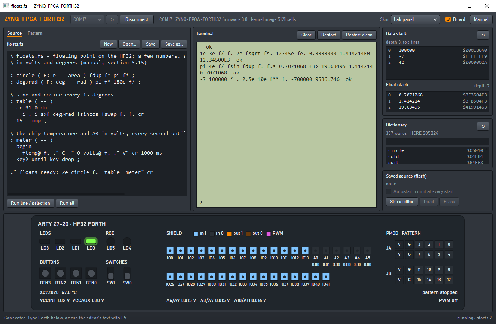
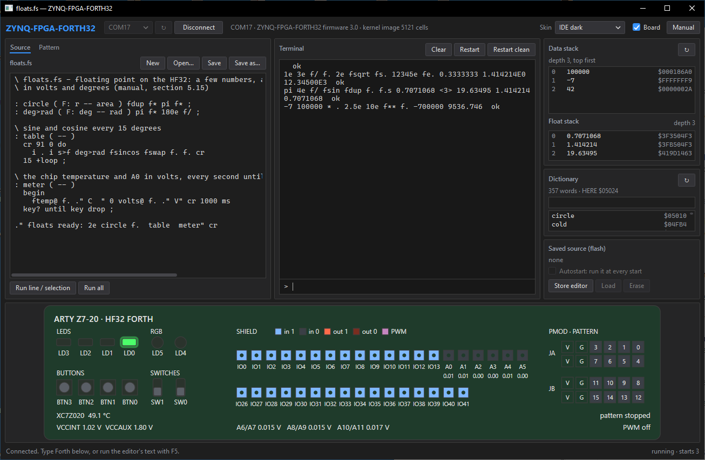
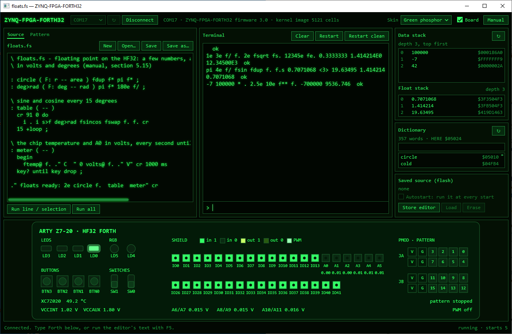
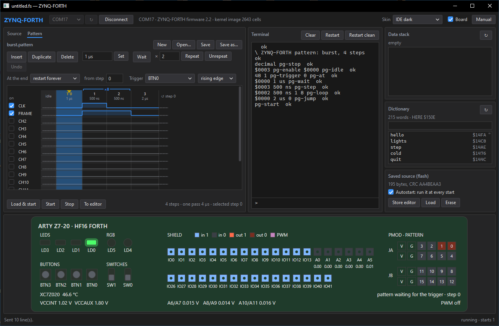

# ZYNQ-FPGA-FORTH32 — User Manual

ZYNQ-FPGA-FORTH32 is a small interactive Forth system for the Digilent Arty Z7-20. Its CPU,
the **HF32**, is a 32-bit stack machine built in the FPGA fabric (PL), with a hardware
floating-point unit for IEEE single precision and a float stack of its own. Every HF32
instruction is a Forth primitive. The Zynq's ARM core loads the Forth kernel into the HF32's
memory and then carries Forth's terminal over the board's USB serial port, where the
**ZYNQ-FPGA-FORTH32 app** or any terminal program talks to it.

It is the 32-bit generation of ZYNQ-FORTH (16-bit, HF16). The board I/O, the app and the
names and stack effects of the words are the same, so sources written for ZYNQ-FORTH run
here; cells, addresses and the CPU are new, and so is floating point (section 5.15).

Besides the board's LEDs, buttons and switches, Forth reaches the Arduino-compatible
**shield connector**: 36 digital pins with four PWM channels, and 9 analog inputs, read by
the FPGA's built-in XADC converter. On the Pmod headers JA and JB, a **pattern generator**
plays 16 digital channels in steps of 5 ns, loaded from Forth or drawn in the app.

This manual covers how to use the system, how the implementation works, and every word
in the kernel. For the instruction encoding and the register maps, see
[design.md](design.md); for the serial protocol, [Protocol.md](Protocol.md).

Contents:

1. [Getting started](#1-getting-started)
2. [The ZYNQ-FPGA-FORTH32 app](#2-the-zynq-fpga-forth32-app)
3. [Working with the interpreter](#3-working-with-the-interpreter)
4. [How the implementation works](#4-how-the-implementation-works)
5. [Word reference](#5-word-reference)
6. [Examples](#6-examples)
7. [Differences from standard Forth](#7-differences-from-standard-forth)
8. [Changing the kernel](#8-changing-the-kernel)
9. [Troubleshooting](#9-troubleshooting)

---

## 1. Getting started

### What you need

- A Digilent **Arty Z7-20** (the -10 has a smaller FPGA and is not supported) and a micro-USB
  cable to the port marked PROG/UART (J14).
- On Windows, the **ZYNQ-FPGA-FORTH32 app**. Any other system can use a terminal program.
- To write ZYNQ-FPGA-FORTH32 into the board's flash: the AMD/Xilinx **Vitis** or **Vivado
  Lab** tools (for `program_flash`), once.

### Put ZYNQ-FPGA-FORTH32 on the board

Paths in this manual are relative to the **ZYNQ-FPGA-FORTH32 folder**: the repository, or
the folder of an unpacked release. Commands run in that folder.

The board starts ZYNQ-FPGA-FORTH32 from its QSPI flash when jumper **JP4** is on **QSPI**.
To write the flash once:

1. Set JP4 to **JTAG** and switch the board on.
2. Run the flash script. It writes the boot image and verifies it:
   - from a release: `.\firmware\program_flash.ps1` (it writes `firmware\BOOT.bin`);
   - from the repository, after building (README): `.\sw\program_flash.ps1` (it writes
     `build\boot\BOOT.bin`).
3. Set JP4 to **QSPI** and switch the board off and on.

The script needs `program_flash` from AMD/Xilinx Vitis 2023.2 (or Vivado Lab). It finds
Vitis by `XILINX_VITIS` or in `\Xilinx\Vitis\2023.2` on any drive; installed elsewhere,
pass its `bin` folder: `.\firmware\program_flash.ps1 -Vitis <Vitis folder>\bin`.

LD0 lights up when Forth runs. The flash keeps ZYNQ-FPGA-FORTH32 until something else is
written there; a Forth source you save from the app (section 2.8) lives in a sector of its
own. That sector is not the one the 16-bit ZYNQ-FORTH uses, so a source saved by
ZYNQ-FORTH stays in the flash untouched, and is there again if you go back to it.

For development, `xsct sw/run.tcl` loads the bitstream and the ARM program over JTAG
instead (JP4 on JTAG; it lasts until the board is switched off).

### Connect

Plug in the USB cable. Windows shows the board as a USB serial port. Its number differs
from PC to PC (COM3, COM7, COM17 …); the Device Manager lists it under *Ports*, and this
manual writes it as **COMx**. Start the app, choose that port and click
**Connect** (chapter 2). Or use a terminal program:

| Setting | Value |
|---|---|
| Port | the board's USB serial port, COMx |
| Speed | 115200 baud, 8 data bits, no parity, 1 stop bit, no handshake |
| Enter key | sends CR (PuTTY's default) |
| Local echo | off (Forth echoes what you type) |

Only one program can use the serial port at a time. That program can also be a host of the [HASE](https://github.com/andiepp/HASE) laboratory, which runs the
board as its Forth-Lab instrument: the board notices the HASE host's protocol and switches
to it, and back as soon as a terminal program or the app sends anything. Output Forth
printed meanwhile and nobody fetched then appears first (docs/Protocol.md, "HASE mode").

For HASE, firmware 3.0 is the same Forth-Lab node as the 16-bit firmware (node type
AE.07.30.80, reporting firmware 3.0), so a HASE Forth-Lab panel built for the 16-bit board
works with it unchanged, showing 16-bit cells: values outside −32768..32767 appear clipped,
and dictionary addresses above `$FFFF` appear as `$FFFF`. Since HASE-Lab's ADR-0092
(2026-11-03) the panel reads the new MCNF functions 0x45 to 0x48 (docs/Protocol.md) for
firmware 3.x: its heading says HF32, the stack view shows 32-bit cells and, under them, the
float stack, dictionary addresses have five hex digits, and its Manual button opens this
manual.

### First session

```
[zynq-forth32] 3.0, kernel 5007 words loaded and verified

HF32 Forth on Arty Z7-20
2 3 + . 5  ok
: square dup * ;  ok
7 square . 49  ok
1e 3e f/ f. 0.3333333  ok
```

Type a line and press Enter. Forth runs the line from left to right and answers ` ok`.
Output appears on the same line as your input, as is usual in Forth. (To see the banner in
a terminal program, connect first and then press Ctrl-R.) The number in the first line is
the size of the kernel image in 32-bit words.

If you know the 16-bit ZYNQ-FORTH, its first steps work here just the same; only the
banner differs, and the last line shows something new: `1e` and `3e` are floating-point
numbers, `f/` divides them and `f.` prints the result (section 5.15).

**Ctrl-R** in a terminal program makes the ARM reload the kernel and restart Forth: the way
out of an endless loop. It also removes all words you have defined. In the app, the
**Restart** button does the same.

---

## 2. The ZYNQ-FPGA-FORTH32 app

The app is a small development environment for the HF32 on Windows:

- an **editor** for Forth source files, sent to Forth in whole or in part;
- a **terminal** that sends lines to Forth and shows what it prints;
- the **data stack**, the **float stack** and the **dictionary**, read from the running
  engine;
- the one **saved source** kept in the board's flash, which runs at every start;
- the **board view**: LEDs, buttons, switches, shield pins and analog inputs, live;
- five **skins**.



*The Lab panel skin after **Run all** of `examples/board-tour.fs`: LD0 and LD2 lit by
`5 led!`, LD5 red and LD4 blue by `12 rgb!`, IO7 driven high, IO8 low and PWM channel 0 on
IO13; the stack holds 12, 100 and -42.*

### 2.1 Connecting

1. Start **ZynqForth32.exe** (version 3.0). It keeps its preferences, and the copy of this
   manual it opens, in `%LocalAppData%\ZYNQ-FPGA-FORTH32`, apart from those of the 16-bit
   ZYNQ-FORTH app, so both apps can be installed side by side.
2. Choose the board's port in the list at the top left (**↻** looks for ports again) and click
   **Connect**. The app remembers the port.
3. The line beside the button shows the port, the firmware version and the kernel size.
   The terminal shows Forth's ` ok`, and the stack, dictionary and saved-source boxes fill.

If the board does not answer, the app says so and disconnects: check that ZYNQ-FPGA-FORTH32
is on the board (chapter 1) and that no other program has the port open. **Disconnect**
frees the port for a terminal program. While the app is connected, only it can use the port.

Start options, for a shortcut: `ZynqForth32.exe [--skin "Lab panel"] [--connect [COMx]] [file.fs | file.pattern]`
connects at once (to COMx, or without it to the port the app remembers), chooses a skin, or
opens a file in the source or pattern editor.

### 2.2 The layout

| Area | Place | What it is for |
|---|---|---|
| Top bar | top | Port, *Connect*, firmware; **Skin**, **Board** and **Manual** (this manual as a PDF, also F1) at the right |
| **Editor** | left | *Source*: Forth source files, sent to Forth in whole or in part; *Pattern*: the pattern generator's editor (section 2.6) |
| **Terminal** | middle | Forth's output, the input line, the restarts |
| **Data stack**, **Float stack** | top right | The two stacks at the last prompt, top first |
| **Dictionary** | right | The words Forth knows, newest first |
| **Saved source (flash)** | bottom right | The program in the board's flash and its autostart |
| Board view | below | The board's I/O, live (tick **Board**) |
| Status line | bottom | The last action's result (red for an error); at the right Forth's state, bytes still queued for Forth and the starts since power-up |

The bars between the columns, and above the board view, can be dragged.

### 2.3 Skins

**Skin** at the top right changes the look at once; the app remembers the choice.

| Skin | Look |
|---|---|
| IDE dark | a dark code editor, blue accent |
| IDE light | the same in light colours |
| Green phosphor | a green CRT terminal: glowing text on black, all text monospaced |
| Amber | the same in amber |
| Lab panel | an instrument front panel with an LCD-like terminal; switches the board view on |





### 2.4 The terminal

- **Output** shows what Forth printed since the app connected, including the echo of each
  line it received. **Clear** empties it; Forth is not affected.
- **Input line** (the `>` at the bottom). Type a line and press **Enter**. **Up** and
  **Down** bring back earlier lines. The rules of section 3.1 apply: at most 80 characters
  per line, plain ASCII (other characters are sent as `?`).
- **Restart** reloads the kernel and starts Forth again. All words you defined are gone, and
  with autostart on, the saved source runs. **Restart clean** does the same without the
  saved source. Restart is also the way to stop a word that never returns, such as a
  `begin … again` loop or one waiting for `key`.

After each line the app reads the data and float stacks; after a line that defines words
(`:`, `create`, `variable`, `constant`, …) it also reads the dictionary.

### 2.5 The editor

The editor area has two tabs: **Source**, the Forth editor described here, and **Pattern**,
the pattern editor (section 2.6).

- The title shows the file's name, or *untitled.fs*, and a star while there are unsaved
  changes; the window title repeats it.
- **New**, **Open…**, **Save** (Ctrl+S) and **Save as…** work on files, usually with the
  extension `.fs`. *New*, *Open…*, *Load* and closing the app ask before they discard
  unsaved changes.
- **Run line / selection**, or **F5** in the editor, sends the selected text. With nothing
  selected, it sends the line with the caret and moves the caret to the next line, so F5
  steps through a file line by line.
- **Run all** (Ctrl+F5) sends the whole text to Forth, as if it were typed. The status line
  shows the progress; long texts go in pieces as Forth reads them, so nothing is lost.
  When Forth has read everything, the app reads the stack and the dictionary.

The text goes to Forth exactly as typed, so the rules of chapter 3 apply. A definition may
span several lines. An error discards the rest of its line only (section 3.4): the
following lines still run, so check the terminal after a long run. If an error interrupted a
definition, fix it and run the definition again.

### 2.6 The pattern editor

The **Pattern** tab above the editor turns the editor area into the pattern generator's
editor (section 5.14). The column grows while it is shown; **Source** brings the Forth
editor back. A pattern is a row of **steps**: each step sets the 16 channels to high or low
for a duration, in ticks of 5 ns.



**The timing diagram.** One row per channel. The first column, **idle**, shows the idle
levels: what the pins carry while the generator is stopped and before the first step (drawn
dashed). Then comes one column per step. A column's header shows the step's number and
duration, and long steps get wider columns, so 5 ns and one second both stay readable. Repeats are brackets above their steps, labelled ×8 or ×∞; a wait step
has a **T** before its number; after the last step the diagram shows what follows: *end:
idle* or *↺ step n*. While a pattern plays on the board, a marker above the header shows the
step the generator is at.

- **Click a cell** to switch the channel's level in that step; **drag** across cells to
  paint that level.
- **Click a cell of the idle column** to switch the channel's idle level. The edge from the
  idle level into step 0 is drawn like any other: it is the first edge the pin makes when
  the pattern starts.
- **Click a header** to select a step; **Shift**+click selects a range. The arrow keys move
  the selection (Shift extends it), **Del** deletes, **Ins** inserts, **Ctrl+D** duplicates,
  **Ctrl+Z** undoes.

**Beside the diagram**, each channel has its **on** box (enabled: the generator drives the
pin; a channel that is not enabled is not driven) and its **name**.

Everything set here, the levels, the idle column, the trigger and what happens at the end,
reaches the board only with **Load & start** (below); **Start** replays what the board
already holds. The trigger only acts on **wait** steps: a pattern without one never waits.

**The toolbar** works on the selected steps:

| Control | What it does |
|---|---|
| **Insert**, **Duplicate**, **Delete** | A step after the selection (like the step before it), a copy of the selection after it, or remove the selection. Repeats move with their steps. |
| duration box, **Set** (or Enter) | The duration of the selected steps: `100 ns`, `2.5 us`, `1 ms`, `0.5 s`; a bare number means ns. Rounded to 5 ns; 5 ns up to 21.47 s. |
| **Wait** | The selected steps wait for the trigger: they show their levels, wait, then hold them for their duration. |
| × box, **Repeat**, **Unrepeat** | Play the selected steps this many times in all (2..65535, or *forever*); remove the repeats inside the selection. Repeats may nest four deep. |
| **Undo** | Back one change (Ctrl+Z). |
| **At the end** | *stop (idle levels)*, or *restart forever* **from step** n. |
| **Trigger** | What wait steps wait for: *software* (`pg-trig` only), BTN0..BTN3 or a shield pin, and the edge. |

**Checks.** Under the diagram the app lists what the generator cannot do (red) and what
may not work as meant (yellow), as you edit:

- errors: repeats that overlap without one containing the other, two repeats ending on the
  same step, more than four nested, a wait step that also ends a repeat, a restart into the
  middle of a repeat, a last step that ends a repeat or waits when the pattern restarts
  (add a step after it), more than 4096 steps;
- warnings: a repeat or restart loop whose steps are too short to keep up (section 5.14,
  *Timing*), wait steps with the software trigger only, and channels with high levels that
  are not enabled.

**The buttons below:**

- **Load & start** sends the pattern to the board as Forth (the terminal shows it) and
  starts it. It is disabled while the pattern has errors.
- **Start** (`pg-start`) plays the loaded pattern again from step 0; **Stop** (`pg-stop`)
  sets the idle levels.
- **To editor** puts the same Forth into the source editor (after any text there), for
  example to save it in flash with *Store editor* and autostart (section 2.8). The
  generator itself forgets the pattern at power-off.

**Files.** **New**, **Open…**, **Save** and **Save as…** work on `.pattern` files (JSON).
The app also opens a `.pattern` file named on its command line. Examples are in
`examples/patterns`: `counter` (a 4-bit counter on channels 0..3 in 1 µs steps),
`burst` (BTN0 starts 8 clock pulses inside a frame signal) and `clock-marker` (a 1 MHz
clock with a marker pulse every 1000 cycles).

### 2.7 The stacks and the dictionary

They are read from the board's memory: the ARM pauses the HF32 for a few microseconds, and
Forth then carries on where it was. **↻** reads again.

**Data stack**

- It is the stack as Forth left it at the last ` ok`, exactly what `.s` would print then,
  but top first: before each line, `quit` copies the stack into a buffer that the ARM can
  read (section 4.6). While a word runs, the box keeps showing the stack of the last prompt.
- Each item shows its position (0 is the top), its value as a 32-bit cell in signed decimal,
  and in hex with 8 digits. The line above gives the depth, or says the stack is empty.

**Float stack**

- Below the data stack, the float stack at the last ` ok` (what `f.s` would print then),
  copied by `quit` in the same way, top first. The line beside the heading gives the depth,
  or says the stack is empty.
- Each item shows its position, its value with up to 7 significant digits (`NaN`, `Inf` and
  `-Inf` as words), and its 32 bits in hex: `1e` shows as `$3F800000` (section 5.15).

**Dictionary**

- The line above the list gives the number of words and `HERE`, the next free byte
  (section 4.3).
- Each word shows its flags (`immediate`, `inline`, section 4.4) and the byte address of its
  code in hex, with 5 digits. Your own words come first.
- The box above the list shows only the words containing its text.
- **Double-click** a word to add it to the terminal's input line.

### 2.8 The saved source

The flash keeps one Forth source. With **autostart** on, it is fed to Forth after the kernel
at power-up and at every restart, as if it were typed (section 4.7).

- The line under the heading shows **none**, the length in bytes and the CRC, or
  **damaged** (its check failed: store it again or erase it).
- **Store editor** writes the editor's text to the flash; a source already stored is
  replaced only after you confirm. At most 65,520 bytes. Writing takes up to about 3
  seconds, and Forth's output waits meanwhile. Storing does not run the source. It keeps
  the autostart setting of the source it replaces; a first source is stored with autostart
  on. A line end is added after the last line if it has none.
- **Load** puts the saved source into the editor, for changes or a file of its own.
- **Erase** removes the saved source after you confirm.
- **Autostart: run it at every start** switches the autostart. It can be ticked only while
  a source is stored.

A saved source should end at the prompt. One that loops for ever, or waits for `key`, holds
Forth at every start. **Hold BTN3 while switching the board on** to skip it, then switch the
autostart off or erase the source. *Restart clean* skips it too.

### 2.9 The board view

Tick **Board** at the top right (the Lab panel skin ticks it for you). The view shows the
board as Forth sees it, read four times a second:

- **LEDs** LD3..LD0 (`led!`) and the **RGB** LEDs LD5 and LD4 in their colour (`rgb!`);
- **Buttons** BTN3..BTN0 and **switches** SW1, SW0, highlighted when pressed or on;
- the **shield** pins, in the order of the board's headers: upper row IO0..IO13 and A0..A5,
  lower row IO26..IO41. Each pin is coloured by what it does: an input reading 1 or 0, an
  output driving 1 or 0, or a pin owned by a PWM channel (marked `~` and the channel
  number). Inputs read 1 when open because of the pull-ups (section 5.11);
- the voltages on A0..A5 under their pins, and on the differential pairs A6/A7, A8/A9,
  A10/A11, the chip temperature and two supplies (section 5.12);
- which PWM channels are on, and their pins;
- at the right, the Pmod headers **JA** and **JB** with the pattern generator's 16 channels,
  each driven high, driven low, or not enabled, and the generator's state: *stopped*,
  *running · step n*, *waiting for the trigger*, *ended*, and *late* when a step ran late
  (section 5.14). With firmware that has no pattern generator the view says so instead.

The view only reads: Forth's I/O is never changed by it.

### 2.10 A worked session

This session writes a small program, tries it, and makes it start with the board. The
program is a running light on LD0 to LD3:

```forth
\ lights.fs - a running light on LD0..LD3
: step ( n -- n' ) 2* dup 16 = if drop 1 then ;
: lights ( n -- ) 1 swap 0 do dup led! step 200 ms loop drop 0 led! ;
: hello ." lights ready" cr ;
hello
```

1. Click **New**, type the program into the editor, click **Save as…** and save it as
   `lights.fs`.
2. Click **Run all**. The terminal shows each line followed by ` ok`, and the last line
   prints `lights ready`. `hello`, `lights` and `step` are now the first three words in the
   dictionary.
3. Tick **Board**. In the input line, type `10 lights` and press Enter. LD0 to LD3 light one
   after the other for two seconds, on the board and in the view. Press **Up** and Enter to
   run it again.
4. Type `1 2 3`: the data stack shows `3`, `2`, `1`, top first. Type `+` and it shows `5`,
   `1`. Type `drop drop`. Type `2e fsqrt`: the float stack shows `1.414214`; `fdrop`
   empties it again.
5. Click **Store editor**. The saved-source line shows the length and CRC, and
   **Autostart** is ticked.
6. Click **Restart**. Forth starts again, and the terminal shows the banner followed by the
   saved source and `lights ready`. From now on, `lights` is there every time the board is
   switched on.
7. To remove it, untick **Autostart** (the source stays in flash) or click **Erase**.

---

## 3. Working with the interpreter

### 3.1 Input line

- A line holds up to 80 characters; anything longer is ignored.
- **Backspace** (or Delete) removes the last character.
- **Enter** runs the line.
- After the line, Forth prints ` ok` if it is interpreting. While you are in the middle of a
  colon definition (compiling), it prints no ` ok`. A definition may span several lines.

### 3.2 Words and numbers

The input is split at spaces. Each piece is looked up in the dictionary; if it is a word, it
runs (or is compiled, inside a definition). If not, Forth tries to read it as a number. If
that fails too, it is an error.

- **Names are case-insensitive:** `DUP`, `Dup` and `dup` are the same word.
- **Names** may contain any characters except space, up to 31 characters.
- **Numbers** are read in the current `base` (10 at start-up). A word that is not an integer
  but has a decimal point or an exponent is a **floating-point number**, which goes to the
  float stack (section 5.15):

| Input | Value |
|---|---|
| `42` | 42 |
| `-42` | −42 |
| `$2A` | 42 (hex regardless of `base`) |
| `-$2A` | −42 |
| `2A` after `hex` | 42 |
| `1.5`, `-2e3`, `1e`, `.5e-2`, `3.` | the floats 1.5, −2000, 1, 0.005 and 3 (in decimal `base` only) |

Integers are 32 bits, −2147483648..2147483647 (or 0..4294967295 unsigned). Larger numbers
wrap around silently: `5000000000 .` prints `705032704` (5000000000 − 4294967296).

### 3.3 Stack notation

This manual describes each word's effect on the data stack as `( before -- after )`, with
the top of the stack on the right. `( a b -- c )` means the word takes `b` (top) and `a`,
and leaves `c`. The effect on the float stack is written after `F:`, so `f>s` is
`( F: r -- ) ( -- n )`: it takes a float and leaves an integer.

| Symbol | Meaning |
|---|---|
| `n` | signed number (−2147483648..2147483647) |
| `u` | unsigned number (0..4294967295) |
| `d`, `ud` | double number, two cells: the low cell, then the high cell on top |
| `x` | any cell |
| `r` | floating-point number, on the float stack |
| `f` | flag: 0 = false, −1 = true (any non-zero counts as true) |
| `c` | character or byte (0..255) |
| `a` | byte address |
| `xt` | execution token (address of a word's code) |
| `h` | header address of a dictionary entry |

### 3.4 Errors

| Message | Cause | What happens |
|---|---|---|
| `name ?` | word not found and not a number | stacks cleared, back to interpreting |
| ` stack underflow` | a word took more items than were on the stack | stacks cleared |
| ` stack overflow` | more than 20 items on the data stack | stacks cleared |
| ` float stack underflow` | a word took more floats than were on the float stack | stacks cleared |
| ` float stack overflow` | more than 20 items on the float stack | stacks cleared |
| ` bad pin` | a pin word got a number that is not a shield pin (section 5.11) | stacks cleared |
| ` bad channel` | `adc@`, `mv@` or `volts@` got a channel above 8 (section 5.12), or a PWM word a channel above 3 | stacks cleared |
| ` bad frequency` | `pwm-hz` got 0, or `pwm-khz` a number outside 1..25000 (section 5.13) | stacks cleared |
| ` too long` | a duration or period, a double number, is too large (section 5.14) | stacks cleared |

After an error, Forth discards the rest of the line, clears the data stack and the float
stack, and returns to interpreting. If the error happened inside a colon definition, that
definition stays unfinished and hidden. It cannot be called, but it still occupies memory.

The stack check runs after each word typed at the terminal, not inside definitions, and
checks both stacks. A word that pushes more than 28 items wraps the stack pointer around,
and this is reported as underflow.

---

## 4. How the implementation works

### 4.1 The pieces

```
 app / PuTTY ── USB-UART ── ARM ──── AXI ── HF32 system in the FPGA
                                              ├─ HF32 CPU, 50 MHz
                                              ├─ multiplier and floating-point unit
                                              ├─ 128 KB RAM: kernel + your words
                                              ├─ 32-byte receive and send FIFOs
                                              ├─ LEDs, RGB LEDs, buttons, switches
                                              ├─ millisecond and microsecond counters
                                              ├─ shield pins: 36 digital inputs/outputs
                                              ├─ XADC: 9 analog inputs, temperature, supplies
                                              └─ pattern generator: 16 Pmod channels, 5 ns steps
```

| Part | File |
|---|---|
| HF32 CPU | `rtl/hf32_cpu.v` |
| Multi-cycle unit: multiplier and floating-point unit | `rtl/hf32_mcu.v` |
| RAM, FIFOs, I/O, shield pins, AXI interface | `rtl/forth_system.v`, `rtl/fifo.v` |
| XADC and its register scanner | `rtl/xadc_scan.v` |
| Pattern generator, on its own 200 MHz clock | `rtl/patgen.v` |
| Forth kernel, written in Forth | `forth/kernel.fs` |
| Cross-compiler and simulator | `tools/hf32.py` |
| ARM loader, terminal and service requests | `sw/src/main.c`, `sw/src/flash.c` |
| The app | `app/src` |

### 4.2 The HF32 CPU

- **32-bit cells.** Numbers, addresses and flags are all 32 bits.
- **Three stacks in hardware**, 32 entries each. The **data stack** holds parameters. Its
  top (T) is a register, and the item below it (N) is directly available, so `+`, `swap`
  or `over` each take one clock. The **return stack** holds return addresses, loop
  indices and items moved there with `>r`. The **float stack** holds floating-point
  numbers; like the data stack, its top (FT) is a register and the item below it (FN) is
  directly available.
- **One instruction per clock** at 50 MHz, so about 50 million primitives per second.
- **A multi-cycle unit** does the multiply and the floating-point operations. The CPU waits
  while it works, so these instructions take a few clocks:

| Operation | Clocks |
|---|---|
| `*`, and the high cell of `um*` | 3 |
| `f+`, `f-` | 6 |
| `f*` | 5 |
| `f/`, `fsqrt` | 31 |
| `s>f` | 4 |
| `f>s`, `ftrunc` | 2 |

- **Five instruction types:** literal (push a number 0..2147483647), jump, conditional
  jump, call, and ALU. A single ALU instruction can also move all three stack pointers,
  store to memory (a cell, a byte or the top float) and return from a subroutine. Every
  instruction is 32 bits, one cell.
- **Fast calls and returns:** a call takes one clock. A return is usually merged into the
  last instruction of a word for free.

The instruction encoding is in [design.md](design.md).

### 4.3 Memory map

| Address | Content |
|---|---|
| `$00000` | jump to `cold` (start-up) |
| `$00004`–`$04E3B` | the kernel: 354 words with their headers, variables and buffers (about 20 KB) |
| `$04E3C`–`$1FFFF` | free for your definitions (about 108 KB). `here` shows the next free byte |
| `$20000`–`$FFFFF` | the RAM again, repeated every 128 KB |
| `$100000`–`$1001AB` | I/O registers (see below) |

Cells are stored little-endian, low byte first. Cell addresses must be multiples of 4: `@`
and `!` ignore bits 0 and 1. There is no check for a full dictionary. Writing past `$1FFFF`
wraps around and overwrites the kernel.

The I/O registers can also be read and written directly with `@` and `!`. Register k is at
`$100000` + 4k; only address bits 8..2 select it, so the registers repeat further up.

| Address | Read | Write |
|---|---|---|
| `$100000` | next received character (removes it from the receive FIFO) | send a character |
| `$100004` | bit 0 = a character has arrived, bit 1 = room to send | – |
| `$100008` | LD0..LD3 | LD0..LD3 |
| `$10000C` | bits 0..3 = BTN0..BTN3, bits 4..5 = SW0..SW1 | – |
| `$100010` | RGB LEDs, see `rgb!` | RGB LEDs |
| `$100014` | millisecond counter, 32 bits | – |
| `$100018` | microsecond counter, 32 bits | – |
| `$100020`, `$100030`, `$100040` | shield port 0, 1, 2: pin levels | – |
| `$100024`, `$100034`, `$100044` | port 0, 1, 2: output latch | output latch |
| `$100028`, `$100038`, `$100048` | port 0, 1, 2: direction, 1 = output | direction |
| `$100080`–`$1000FC` | XADC registers 0..31 (`xadc@`) | – |
| `$100100`–`$10013C` | PWM channels 0..3 (section 5.13) | PWM registers |
| `$100180`–`$1001A8` | pattern generator (section 5.14) | pattern generator |

Section 5.11 explains the ports, 5.12 the XADC registers, 5.13 the PWM registers and 5.14
the pattern generator's.

### 4.4 Dictionary entries

Every word has a header followed by its code:

```
h:      link     cell: address of the previous header (0 ends the list)
h+4:    count    byte: bits 0..4 = name length, bit 5 = inline, bit 6 = hidden,
                       bit 7 = immediate
h+5:    name     the name's characters, padded to a multiple of 4
xt:     code     HF32 instructions
```

`latest` holds the address of the newest header. Searching starts there and follows the
links backwards, so a new definition with an existing name replaces the old one for
everything compiled afterwards.

- **Immediate** words run even while compiling. Examples: `if`, `;`, `."`.
- **Hidden** marks a word whose definition isn't finished yet, so it can't be found.
- **Inline** words are copied into new definitions instead of being called. The
  primitives `dup`, `+`, `@` and others are single instructions. The return-stack words
  `>r`, `r>`, `r@`, `i` and `unloop` *must* be inline: as subroutines they would
  disturb their own return address.

### 4.5 What a colon definition compiles to

`: name ... ;` lays down a header and then, word by word:

| In the source | Compiled as |
|---|---|
| a primitive (`dup`, `+`, `!`, `>r`, `f+`, ...) | its instruction(s), copied inline |
| any other word | one call instruction |
| a number 0..2147483647 | one literal instruction |
| any other number | a literal and an `invert` instruction |
| a float | its 32 bits as a number (above), then a `bits>f` instruction |
| `if` / `while` / `until` | a conditional jump |
| `else` / `again` / `repeat` | a jump |
| `do` | `swap >r >r`, inline |
| `loop` / `+loop` | a call to `(loop)` / `(+loop)`, a conditional jump back, then `unloop` |
| `." text"` | a call to `(.")` followed by the text |
| `;` | a return instruction |

Example: `: square dup * ;` compiles to three instructions, 12 bytes: `dup`, `*`, return.
`: half 0.5e f* ;` compiles to four: the literal `$3F000000`, `bits>f`, `f*`, return.

The cross-compiler that builds the kernel also merges a word's final return into the last
instruction when that is free, and turns a final call into a jump. Definitions typed at the
terminal don't get these two optimizations.

### 4.6 Start-up

After the ARM releases the HF32 from reset, the CPU starts at address 0, which jumps to
`cold`. `cold` sets `base` to 10 and `precision` to 7, prints the banner, switches LD0 on
and enters `quit`, the interpreter loop. `quit` copies the data stack and the float stack
for the app's stack views (`snap`), reads a line (`accept-line`), interprets it
(`interpret`), prints ` ok`, and repeats.

### 4.7 The saved program (autostart)

One Forth source can be saved in the flash (from the app, section 2.8, or with
`python tools/zforth.py store:<file>:on`). With autostart on, the ARM feeds
it to Forth right after `cold`, at power-up and at every restart, exactly as if it were typed:
the definitions are compiled and the commands run. The kernel itself is never changed, so
a faulty source cannot break the start for good:

- **Hold BTN3 while switching the board on** (until the prompt appears, about a second):
  the saved source is skipped and Forth starts with the bare kernel. The same holds at a
  restart or Ctrl-R; the app also offers *Restart clean*, which skips it.
- A source that never returns to the prompt (`begin again`, waiting for `key`) blocks all
  further input; restart without autostart, then fix or erase the saved source.

At most 65,520 bytes can be saved; lines end in CR. While the flash is written (up to about
3 s) Forth's output waits.

The source is kept in a 64 KB flash sector of its own at `0xFE0000`, behind a 16-byte
header that starts with the magic `HF32` (docs/Protocol.md). The 16-bit ZYNQ-FORTH keeps its
saved source at `0xFF0000`, so the two never overwrite each other.

---

## 5. Word reference

The kernel has 354 words. Section 5.22 lists the internal ones, which mainly serve the
interpreter, the compiler and the floating-point words. Where a word differs from standard
Forth, its entry says so.

### 5.1 Data stack

| Word | Stack | Description |
|---|---|---|
| `dup` | `( x -- x x )` | Copy the top item. |
| `drop` | `( x -- )` | Remove the top item. |
| `swap` | `( x1 x2 -- x2 x1 )` | Exchange the top two items. |
| `over` | `( x1 x2 -- x1 x2 x1 )` | Copy the second item to the top. |
| `nip` | `( x1 x2 -- x2 )` | Remove the second item. |
| `tuck` | `( x1 x2 -- x2 x1 x2 )` | Copy the top item below the second. |
| `rot` | `( x1 x2 x3 -- x2 x3 x1 )` | Rotate the third item to the top. |
| `-rot` | `( x1 x2 x3 -- x3 x1 x2 )` | Rotate the top item to third place. |
| `2dup` | `( x1 x2 -- x1 x2 x1 x2 )` | Copy the top two items. |
| `2drop` | `( x1 x2 -- )` | Remove the top two items. |
| `?dup` | `( x -- x x \| 0 )` | Copy the top item only if it is not zero. |
| `depth` | `( -- n )` | Number of items on the data stack, before `depth` itself pushes. |
| `.s` | `( -- )` | Show the stack without changing it: `<3> 1 2 3`, with the depth and the top on the right. |

```
1 2 3 rot .s <3> 2 3 1  ok
```

### 5.2 Return stack

The return stack holds return addresses and, inside `do` loops, the loop index and limit.
You can use it for temporary storage within one definition, but every `>r` needs a
matching `r>` before the word ends or leaves a loop.

| Word | Stack | Description |
|---|---|---|
| `>r` | `( x -- )  R: ( -- x )` | Move the top item to the return stack. |
| `r>` | `( -- x )  R: ( x -- )` | Move the top of the return stack back. |
| `r@` | `( -- x )  R: ( x -- x )` | Copy the top of the return stack. |

These three are inline. They work inside definitions; typed directly at the terminal
they would corrupt the interpreter's own return address.

### 5.3 Arithmetic

All integer arithmetic is on 32 bits and wraps around without warning. For floating-point
arithmetic, see section 5.15.

| Word | Stack | Description |
|---|---|---|
| `+` | `( n1 n2 -- n3 )` | Sum. |
| `-` | `( n1 n2 -- n3 )` | Difference n1 − n2. |
| `*` | `( n1 n2 -- n3 )` | Product, low 32 bits; one instruction (hardware multiplier, 3 clocks). |
| `/` | `( n1 n2 -- n3 )` | Quotient, rounded toward zero: `-7 2 /` gives −3. |
| `mod` | `( n1 n2 -- n3 )` | Remainder, with the sign of n1: `-7 2 mod` gives −1. |
| `/mod` | `( n1 n2 -- rem quot )` | Remainder and quotient (symmetric division). |
| `u/mod` | `( u1 u2 -- rem quot )` | Unsigned division: `-7 2 u/mod` gives 1 2147483644. |
| `*/` | `( n1 n2 n3 -- n4 )` | n1 × n2 / n3 with a 64-bit intermediate product, so the product may exceed 32 bits: `100000 100000 1000 */` gives 10000000. Rounds toward zero. |
| `um*` | `( u1 u2 -- ud )` | Full 64-bit unsigned product as two cells, the high cell on top: `-1 -1 um*` gives 1 −2 (4294967294). |
| `um/mod` | `( ud u -- rem quot )` | Divide a 64-bit unsigned number by u. The quotient must fit in 32 bits (high cell < u). |
| `s>d` | `( n -- d )` | Extend a number to a double number with the same value: `-5 s>d` gives −5 −1. |
| `dnegate` | `( d -- -d )` | Change the sign of a double number. |
| `1+` | `( n -- n+1 )` | Add one. |
| `1-` | `( n -- n-1 )` | Subtract one. |
| `2*` | `( n -- n*2 )` | Double. |
| `2/` | `( n -- n/2 )` | Arithmetic shift right; keeps the sign (`-8 2/` gives −4). |
| `negate` | `( n -- -n )` | Change the sign. |
| `abs` | `( n -- u )` | Absolute value. `-2147483648 abs` stays −2147483648 (as u: 2147483648). |
| `min` | `( n1 n2 -- n )` | Smaller of two signed numbers. |
| `max` | `( n1 n2 -- n )` | Larger of two signed numbers. |

Division is done in software by shift-and-subtract (32 steps). Division by zero gives no
error: `u/mod` then returns −1 as the quotient. `*/` and `um/mod` give a meaningless
result if the quotient doesn't fit in 32 bits.

`*/` is the usual way to scale with fractions: `x 3320 4096 */` multiplies x by
3320/4096 without losing the high bits of the product. `um*` gets its high cell from a
dedicated CPU instruction (the high half of the hardware multiplier).

**Double numbers.** A double number takes two cells, the high cell on top. For `um*`,
`um/mod`, `s>d`, `dnegate`, `d>f` and `f>d` its value is low + high × 2^32, 64 bits. The
duration and period words of sections 5.13 and 5.14 read a double ( lo hi ) as
lo + hi × 65536 instead, as the 16-bit ZYNQ-FORTH did; see `d>ticks` in section 5.14.

### 5.4 Logic and shifts

| Word | Stack | Description |
|---|---|---|
| `and` | `( x1 x2 -- x3 )` | Bitwise AND. |
| `or` | `( x1 x2 -- x3 )` | Bitwise OR. |
| `xor` | `( x1 x2 -- x3 )` | Bitwise exclusive OR. |
| `invert` | `( x -- ~x )` | Invert all bits. Also turns a true flag into false and back. |
| `lshift` | `( x u -- x' )` | Shift left by u bits; u ≥ 32 gives 0. |
| `rshift` | `( x u -- x' )` | Logical shift right by u bits (fills with 0); u ≥ 32 gives 0. |
| `arshift` | `( x u -- x' )` | Arithmetic shift right by u bits (fills with the sign bit): `-8 2 arshift` gives −2, while `-8 2 rshift` gives 1073741822. |

### 5.5 Comparison

The comparison words return −1 (true) or 0 (false). `if`, `until` and `while` treat any
non-zero value as true.

| Word | Stack | Description |
|---|---|---|
| `=` | `( x1 x2 -- f )` | Equal. |
| `<>` | `( x1 x2 -- f )` | Not equal. |
| `<` | `( n1 n2 -- f )` | n1 less than n2, signed. |
| `>` | `( n1 n2 -- f )` | n1 greater than n2, signed. |
| `u<` | `( u1 u2 -- f )` | Less than, unsigned: `-1 1 u<` is false. |
| `u>` | `( u1 u2 -- f )` | Greater than, unsigned. |
| `0=` | `( x -- f )` | x is zero; also a logical NOT. |
| `0<>` | `( x -- f )` | x is not zero. |
| `0<` | `( n -- f )` | n is negative. |
| `0>` | `( n -- f )` | n is positive. |
| `within` | `( n lo hi -- f )` | lo ≤ n < hi; works for signed and unsigned ranges. |

### 5.6 Memory

| Word | Stack | Description |
|---|---|---|
| `@` | `( a -- x )` | Fetch the cell at a (bits 0 and 1 of a ignored). |
| `!` | `( x a -- )` | Store x at a. |
| `c@` | `( a -- c )` | Fetch the byte at a. |
| `c!` | `( c a -- )` | Store the low byte of c at a. |
| `+!` | `( n a -- )` | Add n to the cell at a. |
| `?` | `( a -- )` | Print the cell at a, like `@ .`. |
| `cells` | `( n -- n*4 )` | Size of n cells in bytes. |
| `cell+` | `( a -- a+4 )` | Address of the next cell. |
| `aligned` | `( a -- a' )` | Round a up to a multiple of 4. |
| `cmove` | `( a1 a2 u -- )` | Copy u bytes from a1 to a2, lowest address first. |
| `fill` | `( a u c -- )` | Store the byte c in u bytes from a: `buf 8 32 fill` fills 8 bytes with spaces. |

Floats are stored with `f@` and `f!` (section 5.15).

```
variable x  5 x !  3 x +!  x ? 8  ok
```

### 5.7 Dictionary space

New definitions and data are added at `here`, the next free byte.

| Word | Stack | Description |
|---|---|---|
| `here` | `( -- a )` | Address of the next free byte. |
| `allot` | `( n -- )` | Reserve n bytes at `here` (a negative n gives memory back). |
| `align` | `( -- )` | Round `here` up to a multiple of 4. |
| `,` | `( x -- )` | Align, store x at `here`, advance by one cell. |
| `c,` | `( c -- )` | Store a byte at `here`, advance by one byte. |

```
create table 1 , 2 , 4 , 8 ,
table 2 cells + ? 4  ok
```

### 5.8 Terminal input and output

| Word | Stack | Description |
|---|---|---|
| `key` | `( -- c )` | Wait for a character from the terminal. |
| `key?` | `( -- f )` | True if a character is waiting (does not take it). |
| `emit` | `( c -- )` | Send a character (waits while the send FIFO is full). |
| `cr` | `( -- )` | New line (sends CR and LF). |
| `space` | `( -- )` | Send one space. |
| `spaces` | `( n -- )` | Send n spaces (nothing for n ≤ 0). |
| `zeros` | `( n -- )` | Send n zeros, the character `0` (nothing for n ≤ 0); used by `f.`. |
| `type` | `( a u -- )` | Send u characters starting at a. |
| `.` | `( n -- )` | Print a signed number in the current base, then a space. |
| `u.` | `( u -- )` | Print an unsigned number, then a space: `-1 u.` gives 4294967295. |
| `." text"` | `( -- )` | Compile only: print `text` when the definition runs. |
| `.( text)` | `( -- )` | Print `text` immediately, in a definition or at the terminal. |

Digits above 9 print as capital letters: `hex 255 .` gives `FF`.

```
: hello ." Hello, Arty!" cr ;
hello Hello, Arty!
 ok
```

### 5.9 Number base

| Word | Stack | Description |
|---|---|---|
| `base` | `( -- a )` | Variable holding the base for number input and output (2..36). |
| `hex` | `( -- )` | Set the base to 16. |
| `decimal` | `( -- )` | Set the base to 10. |

`5 2 base ! . decimal` prints 5 in binary: `101`. The base applies to input as well,
so the 5 has to be typed before switching. After `2 base !`, typing `5` gives `5 ?`.
An error doesn't reset `base`; type `decimal` to get back.

Floats belong to base 10: float literals are only read while `base` is 10 (after `hex`,
`1.5` gives `1.5 ?`), and the float output words print digits and exponent in decimal
whatever the base is.

### 5.10 Board I/O

| Word | Stack | Description |
|---|---|---|
| `led!` | `( n -- )` | Set LD0..LD3 from bits 0..3 of n (1 = on). |
| `led@` | `( -- n )` | Read back the LED state. |
| `btn@` | `( -- n )` | Buttons: bit 0 = BTN0 … bit 3 = BTN3, 1 = pressed. Debounced (sampled every 10 ms). |
| `sw@` | `( -- n )` | Switches: bit 0 = SW0, bit 1 = SW1, 1 = on. |
| `rgb!` | `( n -- )` | RGB LEDs: bits 0/1/2 = LD4 red/green/blue, bits 3/4/5 = LD5 red/green/blue. |
| `rgb@` | `( -- n )` | Read back the RGB LED state. |
| `ms` | `( n -- )` | Wait n milliseconds (0..2147483647). |
| `ms@` | `( -- u )` | Millisecond counter, 32 bits; wraps every 2^32 ms (about 49.7 days). |
| `us@` | `( -- u )` | Microsecond counter, 32 bits; wraps every 2^32 µs (about 71.6 minutes). |

The RGB LEDs run at full brightness, which is very bright; there is no dimming.

Differences of counter readings stay right across a wrap-around, as long as the interval
is shorter than the wrap time: `us@ … us@ swap -` gives the microseconds in between.

```
5 led!            \ LD0 and LD2 on
btn@ .            \ hold BTN1 while pressing Enter: prints 2
9 rgb!            \ LD4 red, LD5 red
```

### 5.11 Shield digital pins

The shield connector's digital pins are numbered like their labels on the board:

| Pin numbers | Shield label | Pull-up |
|---|---|---|
| 0..13 | IO0..IO13 (outer digital header) | yes |
| 14..19 | A0..A5, the analog pins used as digital pins | no |
| 26..41 | IO26..IO41 (inner digital header) | yes |

Every pin is an **input after start-up** and after Ctrl-R. `output` makes it drive the
level of its output latch, which starts low.

| Word | Stack | Description |
|---|---|---|
| `output` | `( pin -- )` | Make the pin an output. |
| `input` | `( pin -- )` | Make the pin an input again. |
| `high` | `( pin -- )` | Set the pin's output latch to 1 (3.3 V when it is an output). |
| `low` | `( pin -- )` | Set the output latch to 0. |
| `toggle` | `( pin -- )` | Invert the output latch. |
| `pin!` | `( f pin -- )` | `high` if f is true, otherwise `low`. |
| `pin@` | `( pin -- f )` | Read the level at the pin: true = high. Also works on outputs, where it reads back the driven level. |
| `pin` | `( n -- mask a )` | Bit mask and port address of pin n; ` bad pin` for numbers that are not shield pins. |
| `bset` | `( mask a -- )` | Set the mask bits in the cell at a (a general helper). |
| `bclr` | `( mask a -- )` | Clear the mask bits in the cell at a. |

`high` and `low` work on inputs too: they only set the latch. Setting the level first and
then calling `output` makes the pin start at that level without a short glitch.

```
13 output  13 high          \ IO13 to 3.3 V
13 pin@ . -1  ok
13 low  13 input            \ back to an input
2 pin@ . -1  ok             \ an open input with pull-up reads high
```

**Electrical.** The pins are **3.3 V only; they are not 5 V tolerant.** On the board,
each pin has a 200 Ω series resistor. Keep the current to a few mA, which is enough for an
LED with a resistor. IO0..IO13 and IO26..IO41 have weak pull-ups (tens of kΩ). An open
input reads high, and a button between the pin and GND needs no resistor. A0..A5 have no
pull-up, because a pull-up would shift the analog readings on the same pins. As inputs,
their divider to GND pulls them low.

**Speed.** `toggle`, `high`, `low` and `pin@` take about 1 µs each, so a loop of `toggle`
makes a square wave of a few hundred kHz. Each input is synchronized to the 50 MHz clock
through two flip-flops.

**Whole ports.** The pins are bits of three 16-bit ports. Pin n is bit n mod 16 of port
n / 16. Each port has three registers, cells whose low 16 bits are used: pin levels at
`$100020 + 16p`, the output latch at `$100024 + 16p`, and the direction at `$100028 + 16p`
(1 = output). Writing whole ports changes several pins at once:

```
255 $100028 !               \ IO0..IO7 as outputs
170 $100024 !               \ IO1, IO3, IO5, IO7 high, the others low
$100020 @ 255 and .         \ read IO0..IO7 at once
```

The 16-bit ZYNQ-FORTH had these registers at `$8010`..`$8024`. Sources that use the
pin words run unchanged; sources that use the register addresses need the new ones.

### 5.12 Analog inputs

The Zynq contains the **XADC**, a 12-bit analog-to-digital converter. It measures nine
shield inputs, the chip temperature and six supply voltages. It runs continuously in the
background: each value is an average of 16 conversions and is refreshed about every
millisecond. Reading a value takes no waiting, but after the input has changed, the
reading needs a few milliseconds to settle: wait `10 ms` before reading.

| Channel | Shield pins | Input range | `mv@` returns |
|---|---|---|---|
| 0..5 | A0..A5 | 0..3.3 V to GND | 0..3319 mV |
| 6 | A6 (+) and A7 (−) | 0..1 V, A6 above A7 | 0..999 mV |
| 7 | A8 (+) and A9 (−) | 0..1 V | 0..999 mV |
| 8 | A10 (+) and A11 (−) | 0..1 V | 0..999 mV |

| Word | Stack | Description |
|---|---|---|
| `adc@` | `( ch -- u )` | Raw result of channel 0..8: 0..4095 for 0 to full scale. ` bad channel` for other numbers. |
| `mv@` | `( ch -- mv )` | The channel's voltage in millivolts at the shield pins. |
| `volts@` | `( ch -- ) ( F: -- v )` | The channel's voltage in volts, as a float on the float stack (section 5.15). ` bad channel` for numbers above 8. |
| `temp@` | `( -- n )` | Chip temperature in tenths of a degree Celsius: 452 means 45.2 °C. |
| `ftemp@` | `( F: -- celsius )` | Chip temperature in degrees Celsius, as a float. |
| `.temp` | `( -- )` | Print the chip temperature, for example `45.2 C`. |
| `supply@` | `( reg -- mv )` | A supply voltage in millivolts, from XADC register reg (table below). |
| `xadc@` | `( reg -- u )` | Raw 12-bit result of XADC status register reg (0..31). |
| `vaux` | `( -- a )` | Table of 9 bytes: the XADC auxiliary input of each channel (used by `adc@`). |

| reg | Supply | Nominal |
|---|---|---|
| 1 | VCCINT, FPGA logic core | 1000 mV |
| 2 | VCCAUX, FPGA auxiliary | 1800 mV |
| 6 | VCCBRAM, block RAM | 1000 mV |
| 13 | VCCPINT, ARM core | 1000 mV |
| 14 | VCCPAUX, ARM auxiliary | 1800 mV |
| 15 | VCCO_DDR, DDR3 memory interface | 1500 mV |

```
.temp 44.7 C  ok
0 mv@ . 5  ok               \ A0 open
1 supply@ . 2 supply@ . 15 supply@ . 1018 1801 1489  ok
ftemp@ f. 44.66434  ok
0 volts@ f. 0.005673828  ok
```

The readings shown in this section come from an Arty Z7-20 at room temperature. Your
values will differ slightly.

`volts@` and `ftemp@` work from the same raw results as `mv@` and `temp@`, but don't round
to whole millivolts or tenths of a degree: `volts@` gives the raw result × 3.32 V / 4096 on
A0..A5 and × 1 V / 4096 on the pairs. `ftemp@` uses the XADC's temperature formula,
raw × 503.975 / 4096 − 273.15, while `temp@` uses rounded constants, so the two can differ by
a few hundredths of a degree.

**A0..A5** pass through a 2.32 kΩ / 1 kΩ divider on the board, so 3.32 V at the pin gives
the converter's full 1 V. Voltages above 3.3 V read as 3319 mV. The divider loads the
signal with about 3.3 kΩ to GND, so a source with a high impedance reads too low.

**A6..A11** form three pairs and go to the converter without a divider. Each channel
measures the + pin against the − pin, from 0 to 1 V. For a single-ended signal, connect
the − pin to GND. Keep both pins between 0 and 1 V; a negative difference reads 0.

The A0..A5 pins are also digital pins 14..19 (section 5.11). Using one as an output drives
the analog input of the same pin, which is handy as a self-test:
`14 output 14 high 10 ms 0 mv@ .` prints about 3250 on A0. Make the pin an input again
(`14 input`) before you measure an external signal on it.

**Accuracy.** The converter is calibrated automatically. The divider's 1 % resistors
and the 200 Ω series resistors add an error of a few percent on A0..A5. An open A0..A5
input reads a few mV, an open A6..A11 pair about 15 mV. The temperature is the die
temperature, typically 10–20 °C above the room.

### 5.13 PWM

Four PWM channels, 0..3, make square waves of variable frequency and duty cycle in the
FPGA, independently of Forth: once set, a channel runs on its own, also while Forth
computes or waits for input. Each channel drives **any shield digital pin** (section 5.11).

| Word | Stack | Description |
|---|---|---|
| `pwm-pin` | `( pin ch -- )` | Route channel ch to the pin and start it. The pin becomes an output driven by the channel; ` bad pin` for numbers that are not shield pins. |
| `pwm-off` | `( ch -- )` | Stop the channel. Its pin returns to its own latch and direction (an input after start-up). |
| `pwm-hz` | `( u ch -- )` | Frequency in Hz, 1..25000000. |
| `pwm-khz` | `( u ch -- )` | Frequency in kHz, 1..25000. |
| `pwm-duty` | `( permille ch -- )` | Duty cycle in ‰ (tenths of a percent), 0..1000: 0 is always low, 1000 always high; values outside are clamped. |
| `pwm-clocks` | `( ud ch -- )` | The period directly, in 50 MHz clocks (20 ns), as a double number: low cell, then high cell, read like a duration (`d>ticks`, section 5.14). At least 2: `100000 0 0 pwm-clocks` gives 500 Hz. |
| `pwm` | `( ch -- a )` | Register address of channel ch; ` bad channel` for ch above 3. |
| `ud/u` | `( ud u -- ud' )` | Unsigned 64-bit double divided by an unsigned single, giving a double quotient. |

The order does not matter: frequency, duty and pin can be set in any order and changed at
any time. **A change takes effect at the end of the running cycle,** so a pulse is never
cut short and the frequency or duty can be swept while the channel runs. After start-up,
and after a restart, every channel is off with frequency 25 MHz and duty 0.

```
1000 0 pwm-hz  250 0 pwm-duty  13 0 pwm-pin   \ IO13: 1 kHz, 25 % high
500 0 pwm-duty                                \ now 50 %
2 1 pwm-hz  100 1 pwm-duty  12 1 pwm-pin      \ IO12: 2 Hz, 50 ms pulses
0 pwm-off  1 pwm-off
```

**Resolution.** The period is counted in clocks of 20 ns, so a frequency is exact when
50,000,000 divided by it is a whole number; otherwise the period is rounded down. The duty
cycle is set in steps of 1/65536 of the period, and the pulse is a whole number of clocks:
at 1 kHz (50,000 clocks) the duty can be set to about 0.002 %, at 1 MHz (50 clocks) only
in steps of 2 %. For a fine duty cycle, keep the frequency well below 1 MHz.

Two channels on the same pin are combined (OR). The pin's level can be read with `pin@`
like any output; a loop of `pin@` samples the waveform about every 1.5 µs.

**Checking it without an instrument.** A0 is pin 14 and also analog channel 0, so a PWM
channel on pin 14 can be read back as a voltage: the converter's averaging shows the
duty cycle as a share of the 3.3 V level, with some scatter at high frequencies.

```
100 2 pwm-khz  14 2 pwm-pin
250 2 pwm-duty  20 ms  0 mv@ . 880  ok
750 2 pwm-duty  20 ms  0 mv@ . 2413  ok
1000 2 pwm-duty 20 ms  0 mv@ . 3250  ok
2 pwm-off
```

**Registers.** Channel c is at `$100100` + 16c:

| Address | Register |
|---|---|
| +0 | period, low 16 bits (taken when the high half is written) |
| +4 | period, high 16 bits; writing it sets the period in clocks |
| +8 | duty, in 1/65536 of the period; `$FFFF` = always high |
| +12 | bit 15 = on, bits 5..0 = pin number |

### 5.14 Pattern generator

The pattern generator plays up to 4096 **steps** on **16 digital channels** in ticks of
**5 ns**, from its own 200 MHz clock. A step sets all 16 levels for a duration of 1 tick
(5 ns) up to 4,294,967,295 ticks (21.47 s) and says what happens after it: the next step,
a repeat, a jump, a wait for a trigger, or the end. Forth loads the steps and starts it;
from then on the generator runs on its own, also while Forth computes or waits for input.
The app draws patterns as a timing diagram and loads them for you (section 2.6).

**Pinout.** The channels are on the two Pmod headers **JA** (channels 0..7) and **JB**
(channels 8..15). A Pmod header has two rows of six pins. Drawn as the headers look on
the board: 3.3 V (pins 6 and 12) and GND (pins 5 and 11) at the left, pin 1 at the right
end of the upper row. The board view in the app shows them the same way (section 2.9):

```
          Pmod JA                               Pmod JB
 pin    6    5    4    3    2    1        6    5    4    3    2    1
      3V3  GND  CH3  CH2  CH1  CH0      3V3  GND  CH11 CH10 CH9  CH8
      3V3  GND  CH7  CH6  CH5  CH4      3V3  GND  CH15 CH14 CH13 CH12
 pin   12   11   10    9    8    7       12   11   10    9    8    7
```

| Channel | Pmod pin | FPGA pin | | Channel | Pmod pin | FPGA pin |
|---|---|---|---|---|---|---|
| 0 | JA1 | Y18 | | 8 | JB1 | W14 |
| 1 | JA2 | Y19 | | 9 | JB2 | Y14 |
| 2 | JA3 | Y16 | | 10 | JB3 | T11 |
| 3 | JA4 | Y17 | | 11 | JB4 | T10 |
| 4 | JA7 | U18 | | 12 | JB7 | V16 |
| 5 | JA8 | U19 | | 13 | JB8 | W16 |
| 6 | JA9 | W18 | | 14 | JB9 | V12 |
| 7 | JA10 | W19 | | 15 | JB10 | W13 |

The outputs are 3.3 V CMOS (8 mA, fast edges). All channels change on the same clock edge.
A channel that is not **enabled** is not driven (high impedance), and so are all channels
after power-up and after every start of Forth. JA and JB are the board's fast Pmod headers:
their pins have no series resistors, so **an output is not protected against a short**.
Do not connect an output to GND, 3.3 V or another output. For edges of a few ns, keep the
wires short and use the GND pin of the same header.

**Words.** Durations are double numbers in ticks (low cell, then high cell), which the
first three words make from times. They stay below 2^32 ticks (21.47 s), so with these
words the high cell is always 0; it is there so that sources written for the 16-bit
ZYNQ-FORTH, whose double numbers have 16-bit halves, keep working:

| Word | Stack | Description |
|---|---|---|
| `ns` | `( u -- d )` | u nanoseconds in ticks, rounded down to 5 ns: `100 ns` = 20 ticks. |
| `us` | `( u -- d )` | u microseconds: u × 200 ticks; u up to 21474836, larger gives ` too long`. |
| `msec` | `( u -- d )` | u milliseconds: u × 200,000 ticks; u up to 21474, larger gives ` too long`. Not `ms`: that word waits (section 5.10). |
| `d>ticks` | `( d -- u )` | The ticks of a duration ( lo hi ): lo when hi is 0, otherwise lo + hi × 65536, the 16-bit style; ` too long` when lo or hi is above 65535 then. The step and PWM words use it; `us` and `msec` refuse 2^32 ticks and more themselves (`(dur)`), so their doubles never get the 16-bit reading. |
| `pg-at` | `( step -- )` | The step the next step word stores, 0..4095. |
| `pg-step` | `( levels d -- )` | Store a step: the levels (channel n = bit n) for d ticks, then the next step. |
| `pg-loop` | `( levels d target count -- )` | Store the last step of a repeat: after it, go back to step *target* until the steps *target*..this one have run *count* times in all; 0 = forever. |
| `pg-jump` | `( levels d target -- )` | Store a step that continues at step *target* after it. |
| `pg-wait` | `( levels d -- )` | Store a wait step: it shows its levels, waits for the trigger, then holds them for d ticks. |
| `pg-end` | `( levels -- )` | Store the end: the generator stops with these levels on the pins. |
| `pg-start` | `( -- )` | Play from step 0 (also while playing: start again). |
| `pg-stop` | `( -- )` | Stop; the enabled channels go to their idle levels. |
| `pg-trig` | `( -- )` | The software trigger: a waiting step goes on. |
| `pg-enable` | `( mask -- )` | Which channels the generator drives (bit n = channel n). |
| `pg-idle` | `( levels -- )` | The levels while stopped. |
| `pg-trigger` | `( source edge -- )` | What wait steps wait for. Source: a shield pin 0..41, 48..51 for BTN0..BTN3, 63 for the software trigger only. Edge: 1 rising, 2 falling, 3 both. `pg-trig` works with any source. |
| `pg-status` | `( -- u )` | The status bits, below. |
| `pg-pc` | `( -- step )` | The step playing now. |
| `pg-out@` | `( -- levels )` | The levels on the channels now. |
| `pg-sync` | `( -- )` | Wait until the generator has taken the last command or setting (about 0.1 µs). The words above that command or set it do this themselves. |

The step words refuse to store while a pattern plays: ` pattern running`, then the line
is abandoned. `pg-stop` first. The generator keeps its steps until power-off, also over a
restart of Forth (which stops it and makes all channels undriven).

**Repeats.** `pg-loop` marks the **last** step of a repeated block; the block runs from
*target* to it. A repeat needs no "begin" step, and repeats may **nest up to four deep**, as
long as they end on different steps. A fifth nested repeat does not repeat; status bit 5
shows it.

```
\ a 1 MHz clock on channel 0, a marker on channel 1 every 1000 cycles
pg-stop  3 pg-enable  0 pg-idle  0 pg-at
1 500 ns pg-step              \ 0: clock high
0 500 ns 0 999 pg-loop        \ 1: clock low; steps 0-1 play 999 times
3 500 ns pg-step              \ 2: clock and marker high
0 500 ns 0 pg-jump            \ 3: low; back to step 0, forever
pg-start
```

```
\ BTN0 starts a burst of 8 pulses on channel 0 inside a frame on channel 1
pg-stop  3 pg-enable  0 pg-idle  48 1 pg-trigger  0 pg-at
0 1 us pg-wait                \ 0: wait for BTN0, then 1 us low
3 500 ns pg-step              \ 1: clock and frame high
2 500 ns 1 8 pg-loop          \ 2: clock low; steps 1-2 play 8 times
0 2 us 0 pg-jump              \ 3: 2 us low, then wait again
pg-start
```

**Status.** `pg-status` returns:

| Bit | Value | Meaning |
|---|---|---|
| 0 | 1 | playing (also while waiting) |
| 1 | 2 | waiting for the trigger |
| 2 | 4 | ended (at a `pg-end` step) |
| 3 | 8 | a step word was refused because a pattern played (cleared by `pg-start`, `pg-stop`) |
| 4 | 16 | a step ran late (below; cleared by `pg-start`) |
| 5 | 32 | repeats nested more than four deep (cleared by `pg-start`, `pg-stop`) |
| 6 | 64 | busy: a command has not reached the generator yet |

**Timing.** Every step lasts exactly its duration, also many 5 ns steps in a row. The
generator reads its steps ahead into a 16-step buffer, one step per tick, but each jump or
repeat costs it one tick, which it makes up during longer steps. So one rule applies to
anything that repeats for long: **one pass must last at least one tick more than it has
steps**. A repeat of two 5 ns steps cannot keep up; one 5 ns step and one 10 ns step can. If
the generator falls behind, the step playing is stretched by a tick (its levels stay right)
and status bit 4 is set. The app warns about such repeats before loading.

`pg-start` plays the first step about 0.1 µs later; until then the pins show the idle
levels. A trigger edge is seen 10 to 15 ns after it happens (the input is synchronized to
the 200 MHz clock), then the wait step's duration runs. Edges that come while no step is
waiting are ignored. With nothing connected, shield inputs read 1 (pull-ups), so a pin
trigger on the rising edge needs a signal.

**Checking it without an instrument.** `pg-out@`, `pg-pc` and the board view (section
2.9) show slow patterns live. The millisecond timer measures long ones:

```
: run-time ( -- ms ) ms@ pg-start begin pg-status 4 and until ms@ swap - ;
pg-stop 0 pg-at  1 1000 msec pg-step  0 pg-end  run-time .   \ 1000
```

**Registers.** At `$100180`, register r at `$100180` + 4r; the words above use them.
Details in [PatternGenerator.md](PatternGenerator.md).

| Address | Read | Write |
|---|---|---|
| `$100180` | status | bit 0 start, bit 1 stop, bit 2 software trigger |
| `$100184` | step playing | where the next step is stored |
| `$100188` | levels now | the step's levels |
| `$10018C`, `$100190` | | the step's duration, low and high 16 bits |
| `$100194` | | operation (bits 15..12: 0 step, 1 repeat, 2 jump, 3 wait, 4 end) and target step (bits 11..0) |
| `$100198` | | the repeat count; writing it stores the step and moves to the next |
| `$10019C` | enable mask | enable mask |
| `$1001A0` | idle levels | idle levels |
| `$1001A4` | trigger | trigger: bits 5..0 source, bits 9..8 edge |
| `$1001A8` | where the next step goes | – |

### 5.15 Floating point

The HF32 computes with **IEEE 754 single-precision** floats in hardware: 32-bit numbers
with about 7 significant decimal digits, from about 1.2 × 10^-38 to 3.4 × 10^38 in
magnitude. Floats have a **float stack** of their own, separate from the data stack, as in
Forth 2012: `2e fsqrt` leaves 1.414214 on the float stack and nothing on the data stack.
Like the data stack, the float stack has 32 entries; at the terminal it holds at most 20
(section 3.4), and an error or `abort` empties it. Stack effects on the float stack are
written after `F:` (section 3.3).

**Float literals.** A word that is neither in the dictionary nor an integer is read as a
float if it has an optional sign, digits with at most one decimal point, and an optional
exponent: `E` or `e`, an optional sign and digits. It needs at least one digit, and either
the decimal point or the exponent.

| Input | Value |
|---|---|
| `1.5` | 1.5 |
| `-2e3` | −2000 |
| `1e` | 1 (the digits of the exponent may be left out) |
| `.5e-2` | 0.005 |
| `3.` | 3 |
| `1E10` | 10000000000 |

- Integers are tried first: `3` is the integer 3 on the data stack, `3.` and `3e` are floats.
- Float literals are read only while `base` is 10.
- The literal is rounded to the nearest float. Up to 9 significant digits are used; further
  digits are ignored. A value too large for a float becomes infinity, and one below
  1.2 × 10^-38 becomes 0.
- In a definition, a literal is compiled; the conversion happens only once, when the
  definition is compiled.

**Float stack**

| Word | Stack | Description |
|---|---|---|
| `fdup` | `( F: r -- r r )` | Copy the top float. |
| `fdrop` | `( F: r -- )` | Remove the top float. |
| `fswap` | `( F: r1 r2 -- r2 r1 )` | Exchange the top two floats. |
| `fover` | `( F: r1 r2 -- r1 r2 r1 )` | Copy the second float to the top. |
| `frot` | `( F: r1 r2 r3 -- r2 r3 r1 )` | Rotate the third float to the top. |
| `fnip` | `( F: r1 r2 -- r2 )` | Remove the second float. |
| `fdepth` | `( -- n )` | Number of floats on the float stack. |
| `f.s` | `( -- )` | Show the float stack without changing it, like `.s`: `<3> 1. 2.5 3.`. |

**Arithmetic.** The first five are single instructions of the floating-point unit; the
clocks they take are in section 4.2.

| Word | Stack | Description |
|---|---|---|
| `f+` | `( F: r1 r2 -- r3 )` | Sum. |
| `f-` | `( F: r1 r2 -- r3 )` | Difference r1 − r2. |
| `f*` | `( F: r1 r2 -- r3 )` | Product. |
| `f/` | `( F: r1 r2 -- r3 )` | Quotient r1 / r2. |
| `fsqrt` | `( F: r -- r' )` | Square root; NaN for a negative r. |
| `fnegate` | `( F: r -- -r )` | Change the sign. |
| `fabs` | `( F: r -- r' )` | Absolute value. |
| `fmin` | `( F: r1 r2 -- r3 )` | The smaller of the two. |
| `fmax` | `( F: r1 r2 -- r3 )` | The larger of the two. |
| `ftrunc` | `( F: r -- r' )` | Round toward zero to a whole number: `-2.7e ftrunc` gives −2. |
| `floor` | `( F: r -- r' )` | Round toward minus infinity: `-2.5e floor` gives −3. |
| `fround` | `( F: r -- r' )` | Round to the nearest whole number, halves to the even one: `2.5e fround` gives 2, `3.5e fround` 4. |

**Comparison.** These take floats from the float stack and leave a flag on the data stack.
A comparison with a NaN is always false, and −0 equals 0.

| Word | Stack | Description |
|---|---|---|
| `f<` | `( F: r1 r2 -- ) ( -- f )` | r1 less than r2. |
| `f=` | `( F: r1 r2 -- ) ( -- f )` | r1 equal to r2. `fdup f=` is false only for a NaN. |
| `f>` | `( F: r1 r2 -- ) ( -- f )` | r1 greater than r2. |
| `f0<` | `( F: r -- ) ( -- f )` | r is negative. |
| `f0=` | `( F: r -- ) ( -- f )` | r is zero. |
| `f0>` | `( F: r -- ) ( -- f )` | r is positive. |

**Conversion** between the two stacks:

| Word | Stack | Description |
|---|---|---|
| `s>f` | `( n -- ) ( F: -- r )` | Integer to float; exact up to 2^24 (16777216), rounded above. |
| `f>s` | `( F: r -- ) ( -- n )` | Float to integer, toward zero: `-3.99e f>s` gives −3. Values beyond the integer range give −2147483648 or 2147483647; NaN gives 0. |
| `u>f` | `( u -- ) ( F: -- r )` | Unsigned integer to float: `-1 u>f` gives 4.294967E9. |
| `f>u` | `( F: r -- ) ( -- u )` | Float to unsigned integer, toward zero, for 0 ≤ r < 2^32; a negative r gives 0. |
| `d>f` | `( d -- ) ( F: -- r )` | Double number (64 bits, section 5.3) to float. |
| `f>d` | `( F: r -- ) ( -- d )` | Float to double number, toward zero, for \|r\| < 2^63: `1e15 f>d` gives −1543503872 232830. |
| `f>bits` | `( F: r -- ) ( -- x )` | The float's 32 bits, unchanged: `1e f>bits hex u.` gives `3F800000`. |
| `bits>f` | `( x -- ) ( F: -- r )` | A float from its 32 bits: `$40490FDB bits>f f.` gives 3.141593. |
| `>float` | `( a u -- f ) ( F: -- r \| )` | Convert the string a u, written like a float literal (above). On success the float goes to the float stack and f is true; otherwise f is false and the float stack is unchanged. An empty string gives false. |
| `represent` | `( a u -- n f1 f2 ) ( F: r -- )` | Write the significant digits of r, rounded to u digits (at most 9), to the buffer at a, without sign or point. n is the decimal exponent, so that r = 0.ddd × 10^n; f1 is true if r is negative; f2 is false if r is a NaN or infinite. |

**Memory and defining words.** A float takes one cell, so the float memory words are the
cell words under the names Forth 2012 gives them; the `sf` words (single float) are the same
words again.

| Word | Stack | Description |
|---|---|---|
| `f@` | `( a -- ) ( F: -- r )` | Fetch the float at a. |
| `f!` | `( a -- ) ( F: r -- )` | Store r at a. |
| `sf@`, `sf!` | | The same as `f@` and `f!`. |
| `f,` | `( F: r -- )` | Align, store r at `here`, advance by one cell. |
| `floats`, `sfloats` | `( n -- n*4 )` | Size of n floats in bytes. |
| `float+`, `sfloat+` | `( a -- a+4 )` | Address of the next float. |
| `faligned`, `sfaligned` | `( a -- a' )` | Like `aligned`. |
| `falign`, `sfalign` | `( -- )` | Like `align`. |
| `fvariable name` | `( -- )` | Create a float variable, initially 0. `name` then pushes its address. |
| `fconstant name` | `( F: r -- )` | Create a float constant. `name` then pushes r on the float stack. |
| `fliteral` | `( F: r -- )` | Compile r as a float (immediate), like `literal`. |

```
fvariable speed  2.5e speed f!  speed f@ f. 2.5  ok
9.81e fconstant g  g 2e f* f. 19.62  ok
: rt2 [ 2e fsqrt ] fliteral ;  rt2 f. 1.414214  ok
create ftab 1e f, 2e f, 4e f,  ftab 2 floats + f@ f. 4.  ok
```

**Output**

| Word | Stack | Description |
|---|---|---|
| `f.` | `( F: r -- )` | Print r with `precision` significant digits, then a space. Fixed notation for 10^-7 ≤ \|r\| < 10^9, with trailing zeros removed and always a decimal point: `3.75`, `0.3333333`, `2.`; otherwise scientific notation, also without trailing zeros: `1.E10`, `3.4E38`. |
| `fs.` | `( F: r -- )` | Print r in scientific notation, always with `precision` digits: `3.333333E-1`. |
| `fe.` | `( F: r -- )` | Print r in engineering notation: the exponent is a multiple of 3, with 1 to 3 digits before the point: `12.34500E3`. |
| `precision` | `( -- u )` | The number of significant digits the three words print: 1..9, 7 after start-up. |
| `set-precision` | `( u -- )` | Set `precision`; numbers outside 1..9 are taken as 1 or 9. |

A NaN prints as `NaN`, the infinities as `Inf` and `-Inf`. Negative zero prints as `0.`.

```
1e 3e f/ f. 0.3333333  ok
2e fsqrt fs. 1.414214E0  ok
12345e fe. 12.34500E3  ok
123456789e f. 123456800.  ok
1e10 f. 1.E10  ok
-0.00025e f. -0.00025  ok
1e 0e f/ f. Inf  ok
9 set-precision 0.1e f. 0.100000001  ok
7 set-precision 0.1e f. 0.1  ok
```

`123456789e f.` shows two effects at once: the float nearest 123456789 is 123456792, and
7 digits print it as `123456800.`. With 9 digits, `f.`, `fs.` and `fe.` print every float so
that reading the printed text back gives the same float.

**Elementary functions.** Angles are in radians.

| Word | Stack | Description |
|---|---|---|
| `pi` | `( F: -- r )` | The float nearest π, 3.141593. |
| `fsin` | `( F: x -- r )` | Sine. |
| `fcos` | `( F: x -- r )` | Cosine. |
| `fsincos` | `( F: x -- sin cos )` | Sine and cosine, the cosine on top; faster than both separately. |
| `ftan` | `( F: x -- r )` | Tangent. |
| `fasin` | `( F: x -- r )` | Arc sine, −π/2..π/2; NaN for \|x\| > 1. |
| `facos` | `( F: x -- r )` | Arc cosine, 0..π; NaN for \|x\| > 1. |
| `fatan` | `( F: x -- r )` | Arc tangent, −π/2..π/2. |
| `fatan2` | `( F: y x -- r )` | The angle of the point (x, y), −π..π: `-1e -1e fatan2 f.` gives −2.356194. |
| `fexp` | `( F: x -- r )` | e^x; infinity above 88.72, 0 below −87.34. |
| `fln` | `( F: x -- r )` | Natural logarithm; −Inf for 0, NaN for a negative x. |
| `flog` | `( F: x -- r )` | Logarithm to base 10. |
| `falog` | `( F: x -- r )` | 10^x. |
| `flnp1` | `( F: x -- r )` | ln(1 + x), accurate also for a tiny x: `1e-5 flnp1 fs.` gives `9.999950E-6`. |
| `fexpm1` | `( F: x -- r )` | e^x − 1, accurate also for a tiny x: `1e-5 fexpm1 fs.` gives `1.000005E-5`. |
| `f**` | `( F: r1 r2 -- r3 )` | r1 to the power r2, computed as e^(r2 × ln r1): `2e 10e f**` gives 1024. A negative r1 needs a whole-number r2 (otherwise NaN); 0 to the power 0 is 1. |
| `fsinh` | `( F: x -- r )` | Hyperbolic sine. |
| `fcosh` | `( F: x -- r )` | Hyperbolic cosine. |
| `ftanh` | `( F: x -- r )` | Hyperbolic tangent. |

Each takes a few microseconds: `fatan` about 2 µs, `fsin`, `fln` and `fexp` 3 to 4 µs,
`f**` about 8 µs. Printing is slower: `f.` takes about 0.2 ms to work out its digits.

The analog words `volts@` and `ftemp@` (section 5.12) deliver their readings as floats.

**Semantics.**

- Every arithmetic operation, and every conversion to a float, rounds to the nearest float,
  and to the one with an even last bit when there is a tie.
- There are no subnormal numbers (the tiny floats below 2^-126, about 1.2 × 10^-38): as
  inputs they count as zero, and a result that small becomes zero, keeping its sign.
  `1e-30 fdup f* f.` prints `0.`.
- A result too large in magnitude becomes infinity: `1e30 fdup f* f.` prints `Inf`. A
  division by zero gives an infinity with the right sign.
- 0/0, ∞ − ∞, 0 × ∞ and the square root of a negative number give a NaN ("not a number").
  Every NaN is the same one, `$7FC00000`. It passes through every further operation.
- `f>s`, `f>u`, `f>d` and `ftrunc` round toward zero.

**Accuracy.**

- `f+`, `f-`, `f*`, `f/`, `fsqrt` and `s>f` give the exact result rounded to the nearest
  float (apart from the missing subnormals), as IEEE 754 requires.
- The conversions between text and floats (literals, `>float`, `represent`, `f.`, `fs.`,
  `fe.`) are correctly rounded too: they compute with exact products instead of repeated
  multiplication by 10, and were checked against exact decimal arithmetic on hundreds of
  random values across the whole range of normal floats, with no difference.
- The elementary functions use polynomials after the Cephes single-precision library and
  are within about 2 units in the last place (ulp) of the exact result; near a zero of
  `fsin`, `fcos` or `ftan`, the error is that small in absolute terms. The trigonometric
  functions are accurate for \|x\| up to about 10000 and lose digits beyond: `1e6 fsin` is
  wrong already in the second digit.
- `flnp1` and `fexpm1` use Kahan's forms, so they keep their digits for a tiny x, where
  `1e f+ fln` and `fexp 1e f-` would lose most of them. `f**` loses digits when r2 × ln r1
  is large, for example for r1 close to 1 and a large r2.

### 5.16 Defining words

| Word | Stack | Description |
|---|---|---|
| `: name` | `( -- )` | Start a new definition called `name` and switch to compiling. |
| `;` | `( -- )` | End the definition, make it findable, switch back to interpreting. |
| `variable name` | `( -- )` | Create a variable (one cell, initially 0). `name` then pushes its address. |
| `constant name` | `( x -- )` | Create a constant. `name` then pushes x. |
| `create name` | `( -- )` | Create a word that pushes the address of the data space following it; reserve that space with `allot`, `,` or `c,`. |
| `immediate` | `( -- )` | Make the newest word immediate: it runs during compilation instead of being compiled. |

`fvariable` and `fconstant` do the same for floats (section 5.15).

```
variable count
10 constant ten
create buffer 20 allot
: bump 1 count +! ;
```

The name of a definition can't be found until `;`. So a word can be redefined in terms
of its old version:

```
: sq dup * ;
: sq sq 1+ ;      \ the inner sq is the old one
5 sq . 26  ok
```

Use `recurse` to call the word being defined.

### 5.17 Control structures

These are immediate and work **only inside colon definitions**.

| Structure | Description |
|---|---|
| `f if ... then` | Run the code if f is true. |
| `f if ... else ... then` | Choose between two branches. |
| `begin ... f until` | Repeat until f is true (runs at least once). |
| `begin ... f while ... repeat` | Repeat while f is true, test in the middle. |
| `begin ... again` | Repeat forever (leave with `exit`, or Ctrl-R from the terminal). |
| `limit start do ... loop` | Counted loop: the index runs from start to limit − 1. |
| `limit start do ... n +loop` | Like `loop`, but adds n to the index; ends when the index is ≥ limit. Counts upward only. |
| `exit` | Return from the current word immediately. |
| `recurse` | Call the word being defined. |

Words for use inside `do` loops:

| Word | Stack | Description |
|---|---|---|
| `i` | `( -- n )` | Index of the innermost loop. |
| `j` | `( -- n )` | Index of the next outer loop (in the same definition). |
| `unloop` | `( -- )` | Remove the loop parameters from the return stack. Required before `exit` inside a loop. |

`do` always runs the body at least once, and the index runs up to the limit with
wrap-around. So `0 0 do ... loop` runs 4294967296 times. There is no `?do` and no `leave`.

```
: fact ( n -- n! ) dup 1 > if dup 1- recurse * then ;
7 fact . 5040  ok
: evens 10 0 do i . 2 +loop ;
evens 0 2 4 6 8  ok
: table 3 1 do 3 1 do j i * . loop loop ;
table 1 2 2 4  ok
: find3 10 0 do i 3 = if ." found" unloop exit then loop ." none" ;
```

### 5.18 Compiler and execution

| Word | Stack | Description |
|---|---|---|
| `' name` | `( -- xt )` | Execution token of `name`; **0 if not found** (standard Forth signals an error). |
| `['] name` | `( -- )` | Compile only: compile `name`'s xt as a literal. |
| `execute` | `( xt -- )` | Run the word with this execution token. `0 execute` restarts Forth through `cold`. |
| `[` | `( -- )` | Switch to interpreting inside a definition (immediate). |
| `]` | `( -- )` | Switch back to compiling. |
| `literal` | `( x -- )` | Compile x as a number (immediate). Use it with `[` and `]` to compute values at compile time. |
| `compile,` | `( xt -- )` | Compile a call to xt. |
| `state` | `( -- a )` | Variable: −1 while compiling, 0 while interpreting. |

```
: five [ 2 3 + ] literal ;  ok
five . 5  ok
' five execute . 5  ok
: shout ." loud" ; immediate
: quiet shout ;  loud ok       \ shout ran while quiet was compiled
```

### 5.19 Comments

| Word | Description |
|---|---|
| `( text)` | Ignore everything up to the closing `)`. Commonly used for stack comments. |
| `\ text` | Ignore the rest of the line. |

Both work at the terminal and inside definitions. Like every Forth word, each needs a
space after it.

### 5.20 Interpreter and system

| Word | Stack | Description |
|---|---|---|
| `words` | `( -- )` | List all words, newest first (internal words included). |
| `quit` | `( -- )` | Return to the interpreter loop (the data stack is kept). |
| `abort` | `( -- )` | Clear the data stack and the float stack and return to the interpreter loop. |
| `cold` | `( -- )` | Restart: decimal base, `precision` 7, banner, LD0 on, interpreter loop. Your definitions stay. |

### 5.21 Variables used by the system

| Word | Content |
|---|---|
| `dp` | Dictionary pointer: the value `here` returns. |
| `latest` | Header address of the newest word. |
| `state` | Compile state (section 5.18). |
| `base` | Number base (section 5.9). |
| `tib` | Terminal input buffer (84 bytes). |
| `#tib` | Number of characters in the current input line. |
| `>in` | Parse position in `tib`. |
| `'a`, `'n` | Address and length of the name being searched by `find-name`. |
| `sbuf`, `sn` | Buffer (32 cells) and count used by `.s` and `f.s`. |
| `ssnap`, `sdepth` | The copy of the data stack `snap` makes before each line (20 cells, bottom first) and its depth, -1 while copying; the ARM reads them for the app. |
| `fssnap`, `fsdepth` | The same for the float stack (20 floats, bottom first). |
| `(fprec)` | The digits `precision` returns (section 5.15). |
| `(fbuf)` | The digits `f.`, `fs.` and `fe.` get from `represent`. |
| `(fm)`, `(fx)`, `(fe)`, `(fany)`, `(fneg)` | Digits, exponent and sign of the number `>float` is reading. |
| `(rep-a)`, `(rep-u)`, `(rk)`, `(rkk)` | Buffer, digit count and decimal exponent of `represent`. |
| `(rx)`, `(tl)`, `(ta)`, `(ah)`, `(al)`, `(bh)`, `(bl)`, `(tp)`, `(te)`, `(td)`, `(tq)` | Intermediate results of the exact decimal scaling used by `>float` and `represent`. |
| `(fz)`, `(fk)`, `(fy0)` | Intermediate results of the elementary functions. |

Their names are in parentheses so that they keep out of the way of your own words.

### 5.22 Internal words

These words are visible in `words` and can be used, but they mainly exist for the kernel.

**Loop and string runtime:** these are compiled by `loop`, `+loop`, `."` and `.`.

| Word | Stack | Description |
|---|---|---|
| `(loop)` | `( -- f )` | Increment the loop index; true when it reached the limit. |
| `(+loop)` | `( n -- f )` | Add n to the loop index; true when it is ≥ the limit. |
| `(.")` | `( -- )` | Print the counted string stored after the call and continue behind it. |
| `(u.)` | `( u -- )` | Print u without a trailing space. |
| `digit` | `( u -- c )` | Convert 0..35 to the character `0`..`9`, `A`..`Z`. |

**Parsing** the current input line:

| Word | Stack | Description |
|---|---|---|
| `parse-name` | `( -- a u )` | Skip spaces, return the next space-delimited word (u = 0 at end of line). |
| `parse` | `( c -- a u )` | Return the text up to character c and skip past c. |
| `more?` | `( -- f )` | True if unparsed characters remain on the line. |
| `in-char` | `( -- c )` | The character at the parse position. |
| `/string` | `( a u n -- a+n u-n )` | Remove n characters from the front of a string. |
| `upper` | `( c -- c' )` | Convert a lower-case letter to upper case. |

**Dictionary search:**

| Word | Stack | Description |
|---|---|---|
| `find-name` | `( a u -- h \| 0 )` | Find a visible word by name (case-insensitive), newest first. |
| `match?` | `( h -- f )` | True if header h is visible and matches the name in `'a`/`'n`. |
| `same?` | `( a1 a2 u -- f )` | Compare two strings of length u, case-insensitive. |
| `name>count` | `( h -- a u )` | Name string of a header. |
| `name>xt` | `( h -- xt )` | Execution token of a header. |

**Numbers:**

| Word | Stack | Description |
|---|---|---|
| `number?` | `( a u -- n f )` | Convert a string with optional `-` and `$` prefix; f is true on success. |
| `>number` | `( u1 a1 n1 -- u2 a2 n2 )` | Accumulate digits into u1 until a non-digit; returns the rest of the string. |
| `digit?` | `( c -- n f )` | Value of a digit character and whether it is valid in `base`. |
| `float?` | `( a u -- f ) ( F: -- r \| )` | Like `>float`, but only while `base` is 10; the interpreter's float literals. |

**Floating point:** the helpers of the float words in section 5.15.

| Word | Stack | Description |
|---|---|---|
| `(inf)`, `(nan)` | `( F: -- r )` | Positive infinity; the NaN `$7FC00000`. |
| `fnan?` | `( F: r -- r ) ( -- f )` | True if r is a NaN; r stays. |
| `finf?` | `( F: r -- r ) ( -- f )` | True if r is an infinity; r stays. |
| `tens` | `( -- a )` | A table of the floats 10^0..10^10, all exact. |
| `10^` | `( n -- ) ( F: -- r )` | 10^n from `tens`, for 0 ≤ n ≤ 10. |
| `2^n` | `( n -- ) ( F: -- r )` | 2^n for −126 ≤ n ≤ 127, built from its bits. |
| `(split)`, `(2prod)` | `( F: a b -- p err )` | `(2prod)` gives a × b as the rounded product p plus its exact error err (Dekker's method); `(split)` splits a float into two halves for it. |
| `(fdiv10^)`, `(fmul10^)`, `(scaled)` | | Divide, multiply or scale the number held exactly as `(rx)` + `(tl)` by a power of ten. |
| `(fdigit)`, `(digits?)`, `(fexp)`, `(fbuild)` | | The steps of `>float`: take a digit, test for digits, read the exponent, build the float from digits and exponent. |
| `(decade)`, `(updecade)`, `(round2)`, `(ipow)`, `(digits)` | | The steps of `represent`: estimate the decimal exponent, round p + err to an integer, find the digits. |
| `(fspecial)`, `(fsig)`, `(fixed)`, `(.exp)` | | The steps of `f.`, `fs.` and `fe.`: print NaN and the infinities, count the significant digits, print in fixed notation, print the exponent (in decimal). |
| `(reduce)`, `(sin)`, `(cos)` | | Reduce an angle to −π/4..π/4 and its quadrant; the sine and cosine polynomials. |
| `(f2^n)` | `( n -- ) ( F: r -- r' )` | r × 2^n, for the result of `fexp`. |
| `(f**)` | `( F: r1 r2 -- r3 )` | e^(r2 × ln r1), the core of `f**`. |

**Board I/O:**

| Word | Stack | Description |
|---|---|---|
| `(pg)` | `( levels d op count -- )` | Store one pattern step; the common part of `pg-step`, `pg-loop`, `pg-jump`, `pg-wait` and `pg-end`. |
| `d2*` | `( d -- d' )` | Double a double number. |

**Compiler:**

| Word | Stack | Description |
|---|---|---|
| `header` | `( a u -- )` | Lay down a header with this name and make it `latest`. |
| `flags!` | `( mask -- )` | OR mask into the count byte of `latest`. |
| `hide` | `( -- )` | Mark `latest` hidden (used by `:`). |
| `reveal` | `( -- )` | Clear the hidden flag of `latest` (used by `;`). |
| `compile-call` | `( xt -- )` | Compile a call instruction to xt. |
| `inline,` | `( xt -- )` | Copy xt's instructions up to its return into the definition. |
| `>resolve` | `( a -- )` | Patch the jump at a to point to `here` (used by `then`, `else`, `repeat`). |

**Interpreter:**

| Word | Stack | Description |
|---|---|---|
| `snap` | `( -- )` | Copy the data stack into `ssnap` and the float stack into `fssnap`, and their depths into `sdepth` and `fsdepth`, leaving the stacks as they were; `quit` runs it before each line, for the app's stack views (section 2.7). |
| `accept-line` | `( -- )` | Read one line from the terminal into `tib`, with echo and backspace. |
| `interpret` | `( -- )` | Interpret or compile the rest of the line. |
| `interpret-word` | `( a u -- )` | Handle one word: execute, compile, inline, or convert as an integer or a float. |
| `?stack` | `( -- )` | Check both stacks for underflow or overflow (section 3.4). |

---

## 6. Examples

Each example can be typed at the terminal line by line. The ones that loop until a key is
pressed stop on any key. An input line holds 80 characters, so longer definitions are split
over several lines or into smaller words, as in the button counter.

### 6.1 LEDs and buttons

**Count in binary on the LEDs**
```forth
: count16 16 0 do i led! 250 ms loop 0 led! ;
count16
```

**Buttons light their LEDs**
```forth
: mirror begin btn@ led! key? until key drop 0 led! ;
mirror
```

**Running light, speed from the switches**
```forth
: delay sw@ 1+ 100 * ms ;
: runner begin 4 0 do 1 i lshift led! delay loop key? until key drop 0 led! ;
runner
```
SW0 and SW1 select 100, 200, 300 or 400 ms per step.

**Colour cycle on both RGB LEDs**
```forth
: colours 8 1 do i dup 3 lshift or rgb! 400 ms loop 0 rgb! ;
colours
```

**Reaction timer**
```forth
: wait-btn begin btn@ until ;
: wait-free begin btn@ 0= until ;
: react
  ." wait for the LEDs..." cr
  2000 ms 15 led! ms@
  wait-btn ms@ swap - 0 led!
  ." reaction time " . ." ms" cr
  wait-free ;
react
```

**Button counter**
```forth
variable presses
: btn0? btn@ 1 and ;
: count-press 1 presses +! presses @ led! begin btn0? 0= until ;
: counter
  0 presses !
  begin btn0? if count-press then key? until key drop
  ." BTN0 pressed " presses ? ." times" cr ;
counter
```

### 6.2 Shield connector

These need no extra hardware unless stated. Pin numbers are the shield labels.

**Self-test without wires:** drive A0 as a digital pin and measure it on the analog
channel of the same pin
```forth
14 output  14 high  10 ms  0 mv@ .
14 low  10 ms  0 mv@ .  14 input
```
The first reading is about 3250 mV, the second a few mV. Driving pins 14..19 in turn
lights up channels 0..5, one at a time:
```forth
: all6 6 0 do i mv@ . loop ;
: drive dup output dup high 50 ms all6 input ;
14 drive                    \ prints 3249 5 5 5 9 5
```

**Check the chip's supplies and temperature**
```forth
: supplies 1 supply@ . 2 supply@ . 6 supply@ . 13 supply@ . 14 supply@ . ;
supplies .temp
```

**Temperature monitor:** one line per second
```forth
: thermo begin .temp cr 1000 ms key? until key drop ;
thermo
```

**Blink an LED on IO13** (LED with a 330 Ω resistor from IO13 to GND)
```forth
: blink13 13 output begin 13 toggle 250 ms key? until key drop 13 low ;
blink13
```

**A button on IO2** (push button from IO2 to GND, no resistor; the pull-up holds the pin
high until the button is pressed). LD0 shows the button.
```forth
: watch2 begin 2 pin@ 0= 1 and led! key? until key drop 0 led! ;
watch2
```

**Loopback:** connect IO0 to IO1 with a wire
```forth
0 output  0 high  1 pin@ .  0 low  1 pin@ .  0 input
```
prints `-1 0`.

**Voltmeter on A0:** prints the voltage every half second
```forth
: volts begin 0 mv@ . ." mV" cr 500 ms key? until key drop ;
volts
```

**Bar graph:** a potentiometer (ends to 3.3 V and GND, wiper to A0) lights 0 to 4 LEDs
```forth
: level ( -- n ) 0 adc@ 820 / 1 swap lshift 1- ;
: bar begin level led! 50 ms key? until key drop 0 led! ;
bar
```

### 6.3 Pattern generator

These need no extra hardware: the board view (tick **Board**) shows the Pmod channels.

**A slow counter** on channels 0..3, one count every quarter second, visible in the board
view:
```forth
pg-stop  $F pg-enable  0 pg-at
: counts 16 0 do i 250 msec pg-step loop ;
counts  15 pg-at  15 250 msec 0 pg-jump  pg-start
```
Step 15 is stored again as a jump back to step 0. `pg-pc .` shows the step playing.

**A square wave of 10 MHz** on channel 0 (50 ns high, 50 ns low):
```forth
pg-stop  1 pg-enable  0 pg-at
1 50 ns pg-step  0 50 ns 0 pg-jump  pg-start
```

**Waiting for a button.** A press of BTN1 gives a 2 µs pulse on channel 8 (JB1). The
generator sees the button directly, without debouncing, so a bouncing contact can give a
few pulses:
```forth
pg-stop  $100 pg-enable  49 1 pg-trigger  0 pg-at
0 1 0 pg-wait  $100 2 us pg-step  0 1 0 0 pg-jump  pg-start
pg-status .                 \ 3: playing and waiting
```

**The example patterns** in `examples/patterns` open in the app's *Pattern* tab
(section 2.6): `counter`, `burst` and `clock-marker`.

### 6.4 Floating point

**Degrees and radians.** The trigonometric words work in radians:
```forth
: deg ( F: degrees -- radians ) pi f* 180e f/ ;
30e deg fsin f.             \ prints 0.5
1e fatan 180e f* pi f/ f.   \ prints 45.
```

**Numerical integration** with Simpson's rule: the integral of a function from a to b in
n steps (n even). The function is passed as an execution token, so the same word
integrates any function of one float:
```forth
variable fn  fvariable x0  fvariable h
: x(i) ( i -- ) ( F: -- x ) s>f h f@ f* x0 f@ f+ ;
: f(i) ( i -- ) ( F: -- y ) x(i) fn @ execute ;
: weight ( i -- ) ( F: -- w ) 1 and if 4e else 2e then ;
: simpson ( xt n -- ) ( F: a b -- r )
  >r fn !  fover f- r@ s>f f/ h f! x0 f!
  0 f(i) r@ f(i) f+
  r@ 1 do i f(i) i weight f* f+ loop
  r> drop h f@ f* 3e f/ ;
0e pi ' fsin 100 simpson f.    \ prints 2.
: gauss ( F: x -- y ) fdup f* fnegate fexp ;
0e 3e ' gauss 100 simpson f.   \ prints 0.886207
```
The integral of e^(−x²) from 0 to 3 is 0.8862073. `x0` and `h` hold the start and the step
width, so the loop needs nothing but the index.

**Voltmeter in volts:** the average of 100 readings of A0, every half second
```forth
: avg-volts ( ch -- ) ( F: -- v ) 0e 100 0 do dup volts@ f+ loop drop 100e f/ ;
: voltmeter begin 0 avg-volts f. ." V" cr 500 ms key? until key drop ;
voltmeter
```
The loop takes well under a millisecond, while the XADC refreshes its results about every
millisecond (section 5.12), so most of the 100 readings are the same. For an average over
100 ms, add `1 ms` inside the loop.

---

## 7. Differences from standard Forth

HF32 Forth follows the usual Forth conventions (ANS Forth / Forth 2012) where it has the
same words, with these differences:

**Behaviour**

- `'` returns 0 for an unknown word instead of signalling an error, and `0 execute`
  restarts Forth.
- `/`, `mod` and `/mod` use symmetric division, rounding toward zero (the standard allows
  this or floored division).
- `+loop` counts upward only.
- No warning when a word is redefined.
- Number overflow is not detected; values wrap around at 32 bits.
- The data stack and the float stack hold at most 20 items each at the terminal
  (section 3.4); the return stack has 32 entries.
- Compile-only words (`if`, `do`, `."`, `[']`, ...) are not checked. Typed outside a
  definition, they write stray code into the dictionary and leave junk on the stack.
- The duration and period words (sections 5.13 and 5.14) read a double number ( lo hi ) as
  lo + hi × 65536, for sources written for the 16-bit ZYNQ-FORTH; the other double-number
  words use lo + hi × 2^32.

**Floating point** (the Forth 2012 floating-point word set, with a separate float stack)

- A number with a decimal point but no exponent, like `1.5`, is a float. In standard Forth
  a float literal needs the exponent (`1.5e`), and `1.5` is usually a double-cell integer.
  Both forms work here.
- Float literals and `>float` use the first 9 significant digits and ignore the rest.
  `>float` of an empty string returns false (the standard returns true and 0).
- Floats are single precision, so `float` and `sfloat` are the same size and `sf@` is
  `f@`. There are no subnormal numbers (section 5.15), and every NaN is the same one.
- `f.` switches to scientific notation for very large and very small numbers (outside
  10^-7..10^9), where the standard asks for fixed notation; `fs.` gives that.
- `represent` writes at most 9 digits. The float output words print the exponent in the
  current `base`.

**Not implemented**

- Most double-cell words (`d+`, `m*`, `*/mod`, `#`, `<# #>`, ...); only `um*`, `um/mod`,
  `*/`, `s>d`, `dnegate`, `d>f` and `f>d` exist
- `char` and `[char]` (`[char]` exists only in the cross-compiler), `s"`, `accept`,
  `evaluate`, `source`
- `?do`, `leave`, `case`, `does>`, `postpone`, `defer`, `marker`, `forget`
- `pick`, `roll`, `2swap`, `2over`, `move`, `erase`, `see`, `dump`
- Double-precision floats (`df@`, `df!`, `dfloats`, ...), `f~`, `fvalue`, `fasinh`,
  `facosh`, `fatanh`, and the field words (`ffield:`, ...)

Most of these can be added as definitions in `forth/kernel.fs` (section 8).

---

## 8. Changing the kernel

The kernel lives in `forth/kernel.fs`, written in Forth. `tools/hf32.py` cross-compiles it
on the PC. The cross-compiler understands this subset:

- **Outside definitions:** numbers, float literals, `:`, `:inline`, `variable`,
  `fvariable`, `constant`, `fconstant`, `create`, `allot`, `,`, `f,`, `c,`, `immediate`,
  and comments.
- **Inside definitions:** primitives (always inline), calls to other words (including words
  defined further down), numbers, float literals, `if else then begin until again while
  repeat do loop +loop i unloop exit recurse ." [char] [']`, and `[op] name`, which compiles
  the opcode of primitive `name` as a number (used by the target compiler).
- `:inline name ... ;` makes a word that the target compiler copies inline.

The cross-compiler converts float literals with exact arithmetic, so the kernel's
constants, such as the coefficients of the elementary functions, are correctly rounded
whatever their number of digits.

Workflow:

**1.** Edit `forth/kernel.fs`.

**2.** Test in the instruction-set simulator. It runs the kernel and feeds it input lines
(each at most 80 characters, like typed lines):

```powershell
python tools/hf32.py run forth/kernel.fs -f sim/smoke.txt
python tools/hf32.py run forth/kernel.fs -i "1e 3e f/ f."
```

The simulator computes floats bit for bit like the floating-point unit.
`python tools/test_float_words.py` checks the float literals, `fs.` and the elementary
functions against Python on random values. `sim/manual_examples.txt` and
`sim/manual_checks.txt` hold the examples of this manual, to run the same way.

**3.** Optionally run the same input on the Verilog CPU (Vivado simulator, a few minutes):

```powershell
.\sim\run_sim.ps1
```

`.\sim\run_mcu.ps1` tests the multiplier and floating-point unit alone, against vectors
from the simulator's bit-exact model (`tools/test_fpu.py`, which first checks the model
against IEEE single precision).

**4.** Rebuild the ARM program (which embeds the image) and load it. No new bitstream is
needed:

```powershell
xsct sw/build_sw.tcl
xsct sw/run.tcl
```

For the power-up, build `BOOT.bin` and write it to flash (see the README).

`tools/hf32.py build` also writes `build/forth.map`, the address of every word.

---

## 9. Troubleshooting

| Symptom | Cause and remedy |
|---|---|
| No banner, nothing happens | The banner came before you connected: press Ctrl-R (or *Restart* in the app). Check the port and 115200 baud. If LD0 is dark, ZYNQ-FPGA-FORTH32 is not running: check JP4 (QSPI) and the flash (chapter 1). |
| The app says the board does not answer | Another program has the port, the wrong port is chosen, or the board runs other firmware. |
| The banner says `[zynq-forth]` and `HF16 Forth` | The board runs the 16-bit ZYNQ-FORTH. Flash this project's `BOOT.bin` (chapter 1). |
| `VERIFY FAILED` at the start | The kernel image didn't read back correctly; the CPU stays in reset. Switch the board off and on. |
| A PWM change does not show at once | It waits for the end of the running cycle, so a channel at 1 Hz takes up to a second (section 5.13). |
| The board hangs at power-up, or misbehaves from the start | The saved source does it: switch on with BTN3 held to skip it (section 4.7). |
| A0..A5 read about 0 mV after loading over JTAG | JP4 was on QSPI, so the FSBL from flash ran first. Set JP4 to JTAG, power-cycle and load again. |
| Forth stops responding | A word is in an endless loop or waiting for `key`. Press any key, or Ctrl-R (*Restart* in the app). |
| Your words are gone | A restart or a power cycle reloads the original kernel. Keep useful definitions in a file and run it, save it as the board's source (section 2.8), or add them to `kernel.fs`. |
| Pasting a long text into a terminal program loses characters | The ARM queues up to 64 KB for Forth, so this only happens with very large pastes; the app's *Run all* sends large texts in pieces. |
| Numbers look wrong, or every number gives `?` | Check `base`: after `hex` or `2 base !`, input and output both use that base, and an error doesn't reset it. `decimal` switches back. |
| A long line gives an error near its end | Only 80 characters fit on a line; the rest is dropped, possibly in the middle of a word. Split the line. |
| A shield output doesn't change | The pin is still an input: `n output` first. Check the pin number against the board label (section 5.11). |
| An analog reading is near 3300 mV on A0..A5 without a signal | The same pin is a digital output driving high (`14 input` … `19 input`). |
| An analog reading on A6..A11 stays at 0 | The − pin is above the + pin, or the − pin is not connected to GND. |
| ` pattern running` when storing pattern steps | The generator plays: `pg-stop` first (section 5.14). The app's *Load & start* does it for you. |
| The pattern plays but the Pmod pins stay undriven | The channels are not enabled: `$FFFF pg-enable` (or tick them in the app). Every start of Forth disables them. |
| `pg-status` shows bit 4 (late), the board view *late* | A repeat or jump loop with steps too short for the generator: one pass needs at least one tick more than it has steps (section 5.14, *Timing*). |
| A wait step never goes on | The trigger source or edge is wrong, or the pin never changes (open shield inputs read 1). `pg-trig` goes on by hand. |
| The board view says *firmware 2.2 needed* | The board runs older firmware without the pattern generator: flash the current `BOOT.bin` (chapter 1). |
| A 16-bit source that writes I/O registers directly does nothing, or overwrites words | The I/O registers moved from `$8000` to `$100000` (section 4.3); `$8000` is now ordinary RAM. Use the pin, PWM and pattern words, or the new addresses. |
| A float literal gives `?` | `base` is not 10 (floats are read in decimal only), or the word has no digit, or a character that does not belong in a float (section 5.15). |
| `0.1e 0.2e f+ f.` and friends look slightly off with 9 digits | Floats have about 7 significant digits, and most decimal fractions are not exact in binary: `0.1e` is 0.100000001. Print with the default `precision` of 7. |
| A result is `NaN`, `Inf` or 0 unexpectedly | An operation outside the range: 0/0, the square root or logarithm of a negative number, an overflow beyond 3.4 × 10^38 (infinity) or a result below 1.2 × 10^-38 (zero). Every later operation passes a NaN on (section 5.15, *Semantics*). |
| ` float stack overflow`, or floats left over | Words that leave floats behind, for example a comparison expected to consume them. `f.s` shows the float stack; the app shows it under the data stack. |
| `fsin` of a large angle is wrong | The argument reduction is accurate for \|x\| up to about 10000 (section 5.15, *Accuracy*). Reduce large angles yourself, in whole turns, before converting them to radians. |
