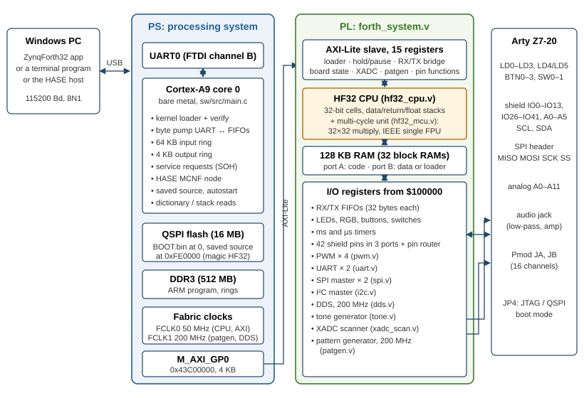
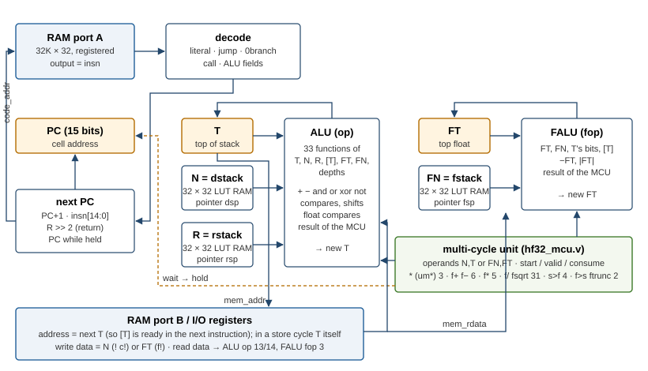
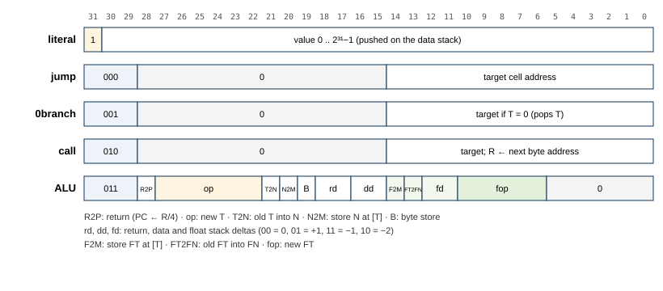
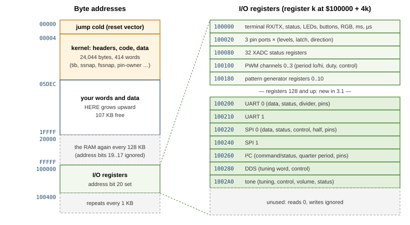
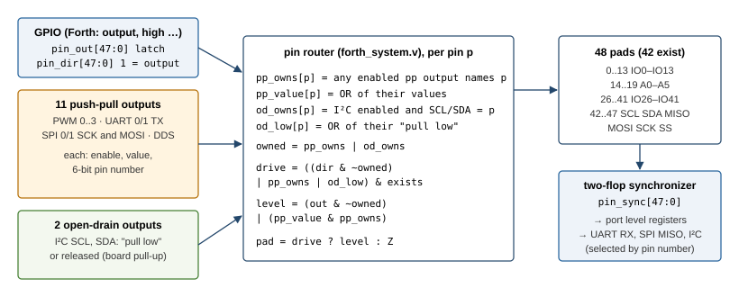

# ZYNQ-FPGA-FORTH32 — Design

This document describes how ZYNQ-FPGA-FORTH32 is built: the HF32 CPU and its
floating-point unit in the FPGA, the memory and the peripherals around it, the program on the
ARM core, the Forth kernel that runs on HF32, and the tools that build and check all of it.
It is written for someone who wants to understand, change or extend the design. How to *use*
the Forth is in the [user manual](Manual.md), the serial protocol in [Protocol.md](Protocol.md)
and the pattern generator's internals in [PatternGenerator.md](PatternGenerator.md).

All figures in this document are those of release 3.1 (firmware 3.1, protocol 2). The PDF
version, `docs/Design.pdf`, is generated from this file by `python tools/manual_pdf.py design`.

## 1 Overview

ZYNQ-FPGA-FORTH32 turns a Digilent Arty Z7-20 into an interactive Forth computer. The Forth
does not run on the board's ARM processor: it runs on **HF32**, a 32-bit stack processor
built in the programmable logic of the Zynq, whose instructions are Forth primitives. Everything
that makes Forth Forth runs on HF32: reading the input line, looking words up, compiling new
definitions, executing them, printing numbers and floats. The ARM core is the CPU's service
processor: it loads the kernel, carries the terminal between the USB serial port and HF32, and
answers the app's and the HASE laboratory's requests on the side.



### 1.1 Design goals

- **A real Forth CPU.** Compiled Forth is native HF32 machine code: a colon definition is a
  sequence of 32-bit instructions, primitives are inlined as single instructions, calls and
  returns cost no extra clock. There is no inner interpreter.
- **Hardware floating point.** IEEE 754 single precision with its own float stack, as in
  Forth-2012: `f+ f- f*` take 5–6 clocks, `f/` and `fsqrt` 31.
- **Correct results.** Every FPU operation rounds to nearest even; decimal input and output
  are correctly rounded; the elementary functions are accurate to within about two units in
  the last place.
- **Compatible with the 16-bit ZYNQ-FORTH.** The same board I/O, AXI registers, word names and
  stack effects, so 16-bit sources run unchanged, and the same HASE node type, so the HASE
  Forth-Lab panel works with it.
- **Hardware peripherals on any pin.** PWM, UARTs, SPI, I²C and a DDS can each be routed to any
  of the 42 shield pins; a tone generator drives the audio jack; a 200 MHz pattern generator
  drives the Pmods.
- **Standalone and HASE-compatible in one firmware.** The same boot image talks to a terminal
  program, to the Windows app and to a HASE host, and switches by itself.
- **Small and checkable.** About 15 % of the Zynq-7020's logic. Every layer has an executable
  model that the layer below is checked against: the FPU bit for bit, the CPU instruction for
  instruction, the kernel against Python's arithmetic.

### 1.2 Who does what

| | FPGA: HF32 running `forth/kernel.fs` | ARM Cortex-A9: `sw/src/main.c` (bare metal) |
|---|---|---|
| Start-up | `cold` prints the banner, sets base and precision, enters `quit` | Loads the 6,011-cell kernel image into HF32's RAM over AXI, reads it back to verify it, releases the CPU from reset |
| Terminal | Reads keys from the RX FIFO, echoes, prints into the TX FIFO | Moves UART bytes into the RX FIFO and the TX FIFO into the UART, through a 64 KB input ring and a 4 KB output ring |
| Interpreting and compiling | All of it: parsing, dictionary search, numbers, floats, compiling, executing | Nothing |
| Arithmetic | Integer ALU and multiplier, FPU (hardware); division, decimal conversion and elementary functions (Forth) | Nothing |
| Board I/O | LEDs, pins, PWM, serial interfaces, DDS, tone, XADC, pattern generator, all as I/O registers at `$100000` | Only reads their state for the app's board view, without disturbing the CPU |
| Service requests (`words`, `stack`, `board`, `source` …) | Nothing; Forth does not notice them | Answers them itself; for the dictionary and the stacks it pauses HF32 for a few microseconds and reads its RAM |
| Saved source | Compiles it as if it were typed | Keeps it in QSPI flash and feeds it into Forth's input at every start (autostart) |
| HASE | Nothing | The whole MCNF node: framing, device functions, the automatic switch between terminal and HASE |

The PC tool `tools/hf32.py` comes in only at build time: it cross-compiles `kernel.fs` into the
image that the ARM loads. Everything typed later is compiled by that image, on the FPGA.

### 1.3 The life of a line

What happens when `2 3 + .` and Enter are typed in the app:

1. The app writes the bytes to the board's USB serial port. The FTDI chip passes them to
   the Zynq's PS UART0.
2. The ARM program's main loop reads each byte from the UART. It is not SOH (a service
   request) and not a byte `0xA_` (an MCNF frame), so it goes into the 64 KB input ring.
3. Whenever the PL's RX FIFO is not full, the loop moves bytes from the ring into it through
   the AXI register `RX_PUSH`.
4. HF32 is waiting in `key`, polling the I/O status register `$100004`. It reads the byte
   from `$100000` (which pops the FIFO), and `accept-line` echoes it with `emit`: a store
   to `$100000` pushes it into the TX FIFO.
5. The ARM loop pops the TX FIFO through `TX_POP` into its output ring, and the ring drains
   into the UART: the echo appears in the app.
6. At the CR, `accept-line` returns. `interpret` takes `2`: not in the dictionary, a number,
   pushed. `3` likewise. `+` is found and executed (in interpret state, the inline primitive's
   code is called). `.` prints `5 `. Then `quit` prints ` ok` and CR LF, takes a snapshot of
   the stacks for the app, and waits for the next line.
7. Meanwhile the app asks for the stack (`SOH stack LF`). The ARM pauses HF32 for a few
   microseconds, reads the snapshot from HF32's RAM, resumes it and answers; the answer is
   placed between two bytes of Forth's output.

### 1.4 Repository map

| Path | Content |
|---|---|
| `rtl/hf32_cpu.v` | the HF32 CPU: decoder, stacks, ALU, next-state logic, memory ports |
| `rtl/hf32_mcu.v` | the multi-cycle unit: 32 × 32 multiplier and the IEEE single-precision FPU |
| `rtl/forth_system.v` | the system around the CPU: RAM, I/O decode, FIFOs, timers, shield pins, pin router, AXI-Lite slave |
| `rtl/pwm.v`, `uart.v`, `spi.v`, `i2c.v`, `dds.v`, `tone.v`, `xadc_scan.v`, `patgen.v`, `fifo.v` | the peripherals |
| `constr/pins.xdc`, `hw/build_hw.tcl` | pin constraints; the Vivado build (block design, bitstream, `.xsa`) |
| `forth/kernel.fs` | the Forth kernel (905 lines of Forth) |
| `tools/hf32.py` | cross-compiler, instruction-set simulator, bit-exact FPU model |
| `sw/src/main.c`, `mcnf_node.c`, `flash.c` | the ARM program, the HASE MCNF framing, the QSPI flash driver |
| `sw/build_sw.tcl`, `build_boot.ps1`, `program_flash.ps1`, `run.tcl` | ARM build, boot image, flash programming, JTAG run |
| `sim/` | RTL testbenches and their input sessions |
| `app/` | the Windows app (C#, WPF, .NET 10) and its tests |
| `tools/test_*.py`, `mcnf_check.py`, `board_session.py` | model checks and board tests |

## 2 Platform and resources

### 2.1 The Zynq-7020 and the Arty Z7-20

The XC7Z020 has two halves. The **processing system (PS)** is a hard dual-core ARM Cortex-A9
with its own peripherals: UARTs, a QSPI flash controller, a DDR3 controller, timers, and
general-purpose AXI ports into the programmable logic. The **programmable logic (PL)** is an
Artix-7-class FPGA fabric: 53,200 LUTs, 106,400 flip-flops, 140 block RAMs of 36 Kb, 220
DSP48 slices and one XADC. The board adds 512 MB of DDR3, 16 MB of QSPI flash, an FTDI
USB–JTAG/UART bridge, LEDs, buttons, switches, an Arduino/chipKIT shield connector, an SPI
header, two Pmod headers and an audio output with a low-pass filter and amplifier.

This design uses only core 0 of the PS, running a bare-metal program without an operating
system, and connects it to the PL through one AXI-Lite slave at `0x43C00000` (4 KB window,
`M_AXI_GP0`). The PS also supplies the PL's clocks:

| Clock | Frequency | Used by |
|---|---|---|
| FCLK0 | 50 MHz | HF32, RAM, all I/O, the AXI-Lite slave (one clock domain) |
| FCLK1 | 200 MHz | pattern generator player and the DDS phase accumulator (5 ns grid) |

Settings and commands for the 200 MHz blocks cross between the two clocks with toggle
handshakes (sections 5.12 and 5.15); everything else is synchronous to FCLK0.

**Why 50 MHz.** HF32 executes one instruction per clock, and its data port is addressed with
the *next* top of stack (section 3.5): the RAM address is the output of the ALU in the same
cycle. That path, ALU plus multiplexers plus the block RAM's address setup, is the critical
one; at 100 MHz it misses by a fraction of a nanosecond. At 50 MHz it has 1.9 ns to spare.
A pipelined CPU would run faster but would lose the property that every primitive takes one
clock and that the compiler never has to schedule around anything except the store hazard.

### 2.2 Resources used

From the implementation report of release 3.1 (`build/hw/utilization.rpt`):

| Resource | Used | Available | % | Mostly in |
|---|---|---|---|---|
| Slice LUTs | 7,986 | 53,200 | 15.0 | CPU datapath, FPU, peripherals, pin router |
| of which LUT RAM | 252 | 17,400 | 1.4 | the three 32-entry stacks, FIFOs |
| Flip-flops | 4,260 | 106,400 | 4.0 | |
| Slices | 2,893 | 13,300 | 21.8 | |
| Block RAM (36 Kb) | 41 | 140 | 29.3 | 32 for the 128 KB Forth RAM, 9 for the pattern memory |
| DSP48 | 15 | 220 | 6.8 | 32 × 32 multiplier, FPU significand multiplier, PWM duty products, tone volume |
| Bonded I/O pins | 94 | 125 | 75.2 | LEDs 10, buttons/switches 6, shield 42, analog 18, Pmods 16, audio 2 |
| XADC | 1 | 1 | 100 | |
| BUFGCTRL | 2 | 32 | 6.3 | the two fabric clocks |

The I/O pins and the XADC are limited by the board, not by the design. Logic and block RAM
leave room for much more: 99 free block RAMs would hold another 400 KB of RAM, and the
remaining 45,000 LUTs would hold several more CPUs.

### 2.3 Timing

| Clock | Worst setup slack | Worst hold slack | Critical path |
|---|---|---|---|
| FCLK0, 50 MHz (20 ns) | 1.887 ns | 0.047 ns | ALU result → RAM port B address |
| FCLK1, 200 MHz (5 ns) | 0.000 ns | 0.071 ns | pattern generator: fetch address → pattern memory |

All constraints are met. The 200 MHz pattern generator's fetch path meets timing with no
margin; it was the tightest path in 3.0 as well (0.23 ns then), and only the placement around it
changed when the 3.1 peripherals were added. A register stage in the fetch path would give it
margin at the cost of one more clock per jump (a possible future change).

## 3 The HF32 CPU

`rtl/hf32_cpu.v`, about 290 lines of Verilog. HF32 follows the scheme of the J1 Forth CPU
(James Bowman, 2010): a dual-stack machine with literal, jump, conditional-branch, call and
ALU instructions, where one ALU instruction can change the top of stack, move the stack
pointers, store to memory and return, all in one clock. HF32 widens the scheme to 32 bits and
adds a third stack for floats, with its own fields in the ALU instruction.



### 3.1 Machine model

- **Cells** are 32 bits. Addresses are byte addresses; a cell must be 4-aligned and is stored
  little-endian.
- **Instructions** are 32 bits, one per cell. The program counter is a 15-bit *cell* address
  (32K cells = 128 KB).
- **Data stack:** the top item T is a register; the items below it (N is the top one) are a
  32-entry register file addressed by the pointer `dsp`.
- **Return stack:** a 32-entry register file addressed by `rsp`; R is its top entry. It holds
  return addresses as **byte** addresses (the PC is the byte address divided by 4) and the
  loop index and limit of `do … loop`.
- **Float stack:** the top float FT is a register; FN is the top of a 32-entry register file
  addressed by `fsp`. Floats are IEEE single bit patterns.
- **Memory:** 128 KB of RAM from address 0, I/O registers from `$100000` (chapter 5).
- **Speed:** one instruction per 50 MHz clock (20 ns), except the multiply and the floating-
  point operations, which stall the CPU until the multi-cycle unit is done (chapter 4).

The stacks live inside the CPU, not in RAM: there is no stack pointer register a program
could read as an address, and the stacks wrap around silently after 32 entries. The kernel
checks the depths after every word it interprets (section 7.6).

### 3.2 Instruction formats



| Bits 31..29 | Instruction | Effect |
|---|---|---|
| `1xx` | literal | push `insn[30:0]` (0 to 2,147,483,647) |
| `000` | jump | PC ← `insn[14:0]` |
| `001` | 0branch | pop T; if it was 0, PC ← `insn[14:0]` |
| `010` | call | push the byte address of the next instruction on the return stack; PC ← `insn[14:0]` |
| `011` | ALU | the fields below, all in one clock |

A negative literal does not fit 31 bits; the compilers emit the inverted value followed by
`invert` (two instructions). Jump, 0branch and call reach any cell of the 128 KB RAM.

ALU instruction fields:

| Bits | Field | Effect |
|---|---|---|
| 28 | R2P | return: PC ← R >> 2 (combined with rd = −1 to pop the address) |
| 27..22 | op | the new T (table in 3.3) |
| 21 | T2N | write the old T into N (`swap`; implied by a data push) |
| 20 | N2M | store N at address T (RAM or I/O) |
| 19 | BYTE | the store writes one byte (`c!`) |
| 18..17 | rd | return stack delta: 00 = 0, 01 = +1 (pushes T), 11 = −1, 10 = −2 |
| 16..15 | dd | data stack delta, coded like rd (+1 pushes the old T into N) |
| 14 | F2M | store FT at address T (`f!`) |
| 13 | FT2FN | write the old FT into FN (`fswap`; implied by a float push) |
| 12..11 | fd | float stack delta, coded like rd |
| 10..6 | fop | the new FT (table in 3.3) |
| 5..0 | – | 0 |

### 3.3 ALU and FALU functions

New T (`op`):

| op | new T | op | new T |
|---|---|---|---|
| 0 | T | 17 | T + 1 |
| 1 | N | 18 | T − 1 |
| 2 | N + T | 19 | T = 0 (−1 or 0) |
| 3 | N and T | 20 | T < 0 (−1 or 0) |
| 4 | N or T | 21 | N × T, low cell (multi-cycle) |
| 5 | N xor T | 22 | T >> 1, arithmetic |
| 6 | not T | 23 | −T |
| 7 | N = T (−1 or 0) | 24 | N × T unsigned, high cell (multi-cycle, for `um*`) |
| 8 | N < T, signed | 25 | N >> T, arithmetic |
| 9 | N < T, unsigned | 26 | FT's bits |
| 10 | N >> T, logical | 27 | FN < FT (−1 or 0) |
| 11 | N << T | 28 | FN = FT (−1 or 0) |
| 12 | R | 29 | FT < 0 (−1 or 0) |
| 13 | the cell at [T] | 30 | FT = 0 (−1 or 0) |
| 14 | the byte at [T] | 31 | FT to integer, toward zero (multi-cycle) |
| 15 | data stack depth | 32 | float stack depth |
| 16 | N − T | | |

New FT (`fop`):

| fop | new FT | fop | new FT |
|---|---|---|---|
| 0 | FT | 7 | FN / FT (multi-cycle) |
| 1 | FN | 8 | √FT (multi-cycle) |
| 2 | T's bits | 9 | T converted to float (multi-cycle) |
| 3 | the cell at [T] | 10 | −FT |
| 4 | FN + FT (multi-cycle) | 11 | \|FT\| |
| 5 | FN − FT (multi-cycle) | 12 | FT truncated toward zero (multi-cycle) |
| 6 | FN × FT (multi-cycle) | | |

Details of the single-cycle functions:

- **Shifts** by 32 or more give 0 (logical) or 32 copies of the sign bit (arithmetic); the
  hardware tests `T[31:5] ≠ 0` and uses `T[4:0]` as the shift count otherwise.
- **Byte loads** pick one of the four bytes of the cell at [T] with `T[1:0]`
  (little-endian).
- **Float compares** run in the ALU in one clock, without the FPU: an exponent field of 0
  (zero or subnormal) compares as +0, a NaN makes every compare false, and otherwise the
  sign and the 31-bit magnitude decide. `fnegate` and `fabs` flip or clear the sign bit.
- **Depths** are the 5-bit stack pointers; with a wrapped pointer they are wrong by 32,
  which the kernel uses to detect underflow.

### 3.4 Primitives

Every Forth primitive is one ALU instruction (two for the stores and two compares). The
encodings, as `tools/hf32.py` defines them:

| Word | Encoding | Fields |
|---|---|---|
| `dup` | `60008000` | T ← T, dd +1 |
| `drop` | `60418000` | T ← N, dd −1 |
| `swap` | `60600000` | T ← N, T2N |
| `over` | `60408000` | T ← N, dd +1 |
| `nip` | `60018000` | T ← T, dd −1 |
| `>r` | `60438000` | T ← N, rd +1 (pushes T), dd −1 |
| `r>` | `63068000` | T ← R, rd −1, dd +1 |
| `r@` | `63008000` | T ← R, dd +1 |
| `+` | `60818000` | T ← N + T, dd −1 |
| `*` | `65418000` | T ← N × T (multi-cycle), dd −1 |
| `@` | `63400000` | T ← [T] |
| `c@` | `63800000` | T ← byte [T] |
| `!` | `60518000 60418000` | store N at [T], T ← N, dd −1; then `drop` |
| `c!` | `60598000 60418000` | the same with BYTE |
| `exit` | `70060000` | R2P, rd −1 |
| `fdup` | `60000800` | fd +1 |
| `fdrop` | `60001840` | FT ← FN, fd −1 |
| `fswap` | `60002040` | FT ← FN, FT2FN |
| `f+` | `60001900` | FT ← FN + FT (multi-cycle), fd −1 |
| `f*` | `60001980` | FT ← FN × FT (multi-cycle), fd −1 |
| `fsqrt` | `60000200` | FT ← √FT (multi-cycle) |
| `s>f` | `60418A40` | T ← N, dd −1, FT ← float(T), fd +1 |
| `f>s` | `67C09840` | T ← int(FT), dd +1, FT ← FN, fd −1 |
| `bits>f` | `60418880` | T ← N, dd −1, FT ← T, fd +1 |
| `f@` | `604188C0` | T ← N, dd −1, FT ← [T], fd +1 |
| `f!` | `6041D840 60000000` | store FT at [T], T ← N, dd −1, FT ← FN, fd −1; then a no-op |
| `f<` | `66C09840 60001840` | T ← FN < FT, dd +1, FT ← FN, fd −1; then `fdrop` |

The instructions that move values between the stacks show what one ALU instruction can do:
`s>f` pops the data stack, converts the old T and pushes the result on the float stack, all in
one instruction (which waits 4 clocks for the conversion). Because a data push writes the old T
into N and a pop takes N into T, the "new T" of a pop is N and the value consumed is the old T.

### 3.5 Memory ports and timing

HF32 sits between the two ports of a synchronous dual-port RAM whose outputs are registered
(the block RAM's read data appears one clock after the address). Two tricks give it
single-cycle instructions with such a RAM:

- **Code port.** `code_addr` is the *next* PC, computed combinationally from the current
  instruction (PC + 1, a jump or call target, a taken 0branch, or R >> 2 on a return). The RAM
  registers it at the clock edge, and the instruction at the new PC is on `insn` during the
  next cycle. So there is no fetch stage: a jump, call or return costs nothing.
- **Data port.** `mem_addr` is the *next* T. Whatever T becomes at the end of this
  instruction, the RAM is reading the cell at that address meanwhile, so in the next
  instruction `mem_rdata` already holds [T]. That is why `@` (op 13: T ← [T]) takes one
  clock: the load was started speculatively by the instruction before it.

**The store hazard.** A store needs the data port to address the *current* T, so in a store
cycle `mem_addr` is T instead of the next T. The instruction after a store therefore finds
the stored address' data on `mem_rdata`, not [T]. The rule, kept by both compilers: the
instruction directly after a store does not read memory (op 13/14, fop 3). `!` and `c!` end
with a plain `drop`, `f!` with a no-op. The cost is one instruction per store, and nothing to
schedule anywhere else.

**I/O reads with side effects.** Because loads are started speculatively, the I/O decoder may
"read" a register just because T happens to hold its address. Reads are therefore free of side
effects, with two exceptions that pop a FIFO: the terminal's RX data register (`$100000`) and
the UARTs' data registers. Those pop only when the instruction actually consumes [T]: the CPU's
`mem_rd` output is set by an ALU instruction with op 13 or 14 or fop 3, and the pop is
qualified with the address in T (`mem_rd && T = $100000`).

**Returns** use byte addresses, so `>r` and `r>` can move return addresses as ordinary
numbers: `execute` is `>r exit` (push the execution token on the return stack and return into
it), and `(.")` reads the inline string after its call by taking its own return address,
skipping the string and pushing the address back.

### 3.6 Stalls

The CPU has one freeze mechanism, `hold`, for two causes:

- **The multi-cycle unit is busy** (`u_wait`): the current instruction needs the multiplier or
  the FPU and the result is not valid yet.
- **The ARM pauses the CPU** (`stall` from `forth_system`): CTRL bit 1 and one cycle after it.

While held, no register changes, no stack is written, no store happens and no FIFO is
popped. The code port re-reads the current instruction (`code_addr` = PC) and the data port
re-reads the current T (`mem_addr` = T), so that one clock after the hold ends, both RAM
outputs are valid again: this is why the system keeps the stall one cycle longer than the
ARM's pause bit (section 6.3). The program cannot observe a hold, except through the timers.

### 3.7 Next-state logic

For each instruction class the next state is (from `hf32_cpu.v`):

| Class | T | Data stack | Return stack | PC |
|---|---|---|---|---|
| literal | value | push old T | – | PC + 1 |
| jump | – | – | – | target |
| 0branch | N | pop | – | target if T = 0, else PC + 1 |
| call | – | – | push (PC + 1) × 4 | target |
| ALU | `op` result | `dsp += dd`; write old T if T2N or dd = +1 | `rsp += rd`; write T if rd = +1 | R >> 2 if R2P, else PC + 1 |

and for ALU instructions also FT ← `fop` result, `fsp += fd`, write old FT if FT2FN or
fd = +1. The stack register files are written at the *new* pointer: a push increments the
pointer and writes the old top there in the same clock.

## 4 The multi-cycle unit and the FPU

`rtl/hf32_mcu.v` holds everything that takes more than one clock: the 32 × 32 multiplier and
the floating-point unit. It is a single state machine with one operation in flight.

### 4.1 Interface to the CPU

The CPU decodes the instruction combinationally and, if `op` or `fop` names a multi-cycle
operation, raises `u_need` with a 4-bit operation code and two operands (N and T for the
multiplies, FN and FT for the binary float operations, FT or T for the unary ones). The
handshake:

1. `start` (`u_need`, unit idle, no result waiting, not stalled): the unit latches the
   operation and the operands.
2. While the unit works, `u_wait` holds the CPU; the instruction stays on `insn`.
3. When the result is valid, the hold ends and the instruction commits: the ALU or FALU
   takes `u_result` as the new T or FT, and the stacks move as the instruction says.
   `consume` returns the unit to idle in the same clock.

If the ARM pauses the CPU while an operation runs, the operation finishes and its result
waits in the `DONE` state until the CPU continues.

| Operation | Code | Operands | Clocks (decode included) |
|---|---|---|---|
| N × T, low cell (`*`) | 0 | N, T | 3 |
| N × T unsigned, high cell (`(um*)`) | 1 | N, T | 3 |
| FN + FT, FN − FT | 2, 3 | FN, FT | 6 |
| FN × FT | 4 | FN, FT | 5 |
| FN / FT | 5 | FN, FT | 31 |
| √FT | 6 | FT | 31 |
| T to float (`s>f`) | 7 | T | 4 |
| FT to integer (`f>s`) | 8 | FT | 2 |
| FT truncated (`ftrunc`) | 9 | FT | 2 |

Operations whose result is decided by a special operand (a NaN, an infinity, a zero) finish
in the unpack state, in 2 clocks.

### 4.2 Number format and semantics

IEEE 754 binary32: sign, 8-bit biased exponent, 23-bit fraction with a hidden leading one.
The unit implements these semantics, which the kernel and the model share:

- **Rounding:** round to nearest, ties to even, for every operation.
- **Subnormals** are not supported: an input with exponent field 0 counts as zero (with its
  sign), and a result whose magnitude after rounding is below 2⁻¹²⁶ becomes ±0 (flush to
  zero). This keeps the normalizer simple and costs nothing in practice for a laboratory
  Forth.
- **Overflow** gives ±∞.
- **NaN:** every NaN result is the quiet NaN `0x7FC00000`. 0/0, ∞ − ∞, 0 × ∞ and √(negative)
  produce it; any NaN operand propagates it.
- **Signed zeros:** x/0 is ±∞ with the XOR of the signs, −0 + −0 = −0, x − x = +0,
  √−0 = −0.
- **Conversions:** `f>s` truncates toward zero and saturates at −2,147,483,648 and
  2,147,483,647; NaN gives 0. `s>f` rounds to nearest even (integers above 2²⁴ do not all
  fit).

### 4.3 The datapath

Inside the unit, a finite value being worked on is `m × 2^(e − 127) / 2^48`: `m` is a 50-bit
significand whose leading one belongs at bit 48, bit 49 catches a carry, and bit 0 is a
**sticky** bit that collects the OR of all bits shifted out to the right. With the leading one
at bit 48, bits 48..25 are the 24 bits of the result, bit 24 is the round bit and bits 23..0
(with the sticky bit) decide whether anything lies beyond it.

The states:

| State | Clocks | What it does |
|---|---|---|
| IDLE | – | waits for `start`; latches operation and operands |
| MUL, MULOUT | 2 | `prod ← a × b` (64 bits, DSP48 cascade), then the low or high cell |
| UNPACK | 1 | classifies the operands (zero/subnormal, infinity, NaN), resolves special cases, sets up the working registers |
| ALIGN | 1 | addition: shifts the smaller operand right by the exponent difference, ORing the bits shifted out into bit 0 (a difference of 50 or more leaves only the sticky bit) |
| ADD | 1 | adds or subtracts the aligned significands (effective subtraction when the signs differ) |
| FMUL | 1 | `m ← ma × mb` (24 × 24 = 48 bits), placed at bits 49..2 |
| DIV | 27 | restoring division, one quotient bit per clock |
| SQRT | 27 | restoring square root, one root bit per clock |
| NORM | 1 | a zero result (x − x) gives +0; a carry into bit 49 shifts right by one (keeping the sticky bit); otherwise a leading-zero count over bits 48..0 and one left shift |
| ROUND | 1 | rounds to nearest even, detects overflow and underflow, packs the result |
| DONE | – | the result waits for `consume` |

**Addition** puts the larger magnitude first (comparing the 31-bit magnitudes, which order
correctly as integers), so the result takes its exponent and, for an effective subtraction,
its sign. The aligned difference can cancel any number of leading bits, which the single
normalization shift handles.

**Multiplication** adds the exponents (minus the bias) and multiplies the 24-bit significands
with the hidden ones. The product of two values in [1, 2) is in [1, 4), so the leading one is
at bit 47 or 46 of the product; placed at bits 49..2 of `m`, the normalizer sees it at bit 49
or 48 and needs at most a one-bit right shift.

**Division** subtracts the exponents and runs 27 steps of restoring division on the
significands: the partial remainder starts as the dividend's significand; at each step, if it
is at least the divisor, the divisor is subtracted and a 1 enters the quotient, and the
remainder doubles. After 27 bits the quotient holds the 24 result bits, the round bit and two
more; the sticky bit is "the remainder is not zero". Because the dividend's significand may be
smaller than the divisor's, the first quotient bit can be 0, which the normalizer fixes.

**Square root** halves the exponent: with the unbiased exponent made even (the significand
shifted one bit left if it is odd), √(X × 2^2k) = √X × 2^k. The radicand (the significand
followed by 28 zero bits) is consumed two bits per step; each step compares the remainder,
extended by the next two radicand bits, with the trial value `(q << 2) | 1` and, if it is
not smaller, subtracts it and appends a 1 to the root `q`. 27 steps give 27 root bits and the
final remainder's non-zero test is the sticky bit. The result is exact or correctly rounded,
as IEEE requires.

**Rounding** adds one to bits 48..25 when the round bit is set and either the sticky bits
(23..0) are not all zero or the result's lowest bit (25) is set: round half to even. A carry
out of the 24 bits (1.111…1 rounding up to 10.000…0) increments the exponent and leaves a zero
fraction. A biased exponent of 255 or more gives ±∞; 0 or less gives ±0.

**Conversions** bypass most of the datapath. `s>f` loads `|T| << 17` into `m` with the
exponent of 2³¹ (158) and lets NORM and ROUND do the rest. `f>s` shifts the 24-bit significand
by the exponent directly in UNPACK (for 127 ≤ e < 158; smaller magnitudes give 0, larger ones
saturate). `ftrunc` clears the fraction bits below the binary point with a mask (for
128 ≤ e < 150; |x| < 1 gives ±0, e ≥ 150 is already integral).

### 4.4 Verification of the FPU

`tools/hf32.py` contains a Python model of the unit (`f_add`, `f_mul`, `f_div`, `f_sqrt`,
`i_to_f`, `f_to_i`, `f_trunc`, `f_cmp`) that follows the same algorithms step by step:
the same 50-bit significand, the same alignment with sticky bit, the same restoring loops. The
instruction-set simulator uses it, so programs give the same bits in the simulator and on the
board.

- `tools/test_fpu.py` checks the model against IEEE results computed with Python's doubles
  rounded to single precision, with this machine's rules applied (flush to zero, one NaN).
  For +, −, ×, / and √ a double has more than twice the precision of a single, so rounding the
  double result once more gives the correctly rounded single result. The script checks
  special values and boundaries and, by default, 200,000 random operand pairs.
- The same script writes test vectors; `sim/tb_mcu.v` (run with `sim/run_mcu.ps1`) feeds them
  to the RTL, compares every result bit for bit and reports the most cycles each operation took.

So the chain is: IEEE (through Python) → model → RTL, and the simulator that runs the kernel
uses the model.

## 5 Memory and I/O

`rtl/forth_system.v` instantiates the CPU and everything it talks to. All of it runs on the
50 MHz clock except the 200 MHz halves of the pattern generator and the DDS.



### 5.1 RAM

The RAM is 32K × 32 bits (128 KB), inferred as true dual-port block RAM: 32 RAMB36 tiles.

- **Port A** fetches instructions: address `code_addr`, registered output `insn`.
- **Port B** is the CPU's data port. While the CPU is held in reset (loading) or paused, it is
  given to the ARM: address `MEM_ADDR`, write data `MEM_DATA` (section 6.1).
- **Byte writes** use the block RAM's byte-write enables: for `c!` the byte is replicated
  into all four lanes and only lane `addr[1:0]` is enabled.
- **Decoding:** address bit 20 selects I/O. Below it, only bits 16..2 address the RAM, so the
  RAM repeats every 128 KB up to `$FFFFF`.

Code and data share the RAM. That is what allows the Forth compiler, running on HF32, to write
new code with ordinary stores and then call it.

### 5.2 The I/O read path

I/O register *k* sits at `$100000 + 4k`; address bits 9..2 select one of 256 registers, so the
map repeats every 1 KB. Registers 0..127 are the board I/O of the 16-bit design; registers
128 and up (`$100200`…) are the 3.1 peripherals.

An I/O read must look like a RAM read to the CPU: the data must be valid one clock after the
address. The decoder therefore registers its result (`io_rdata`), selecting by the address of
the same clock, and remembers whether that address was I/O (`io_sel`); the data port's read
data is `io_sel ? io_rdata : ram_doutb`. Writes go to the addressed block in the store cycle
itself. Unused registers read 0 and ignore writes.

### 5.3 I/O map

| Address | Read | Write |
|---|---|---|
| `$100000` | next received byte (pops the RX FIFO) | send a byte (pushes the TX FIFO) |
| `$100004` | bit 0 = a received byte is waiting, bit 1 = the TX FIFO has room | – |
| `$100008` | LD0..LD3 | LD0..LD3 |
| `$10000C` | bits 3..0 = BTN3..BTN0 (debounced), bits 5..4 = SW1..SW0 | – |
| `$100010` | RGB LEDs: bits 2..0 = LD4 B, G, R; bits 5..3 = LD5 B, G, R | the same |
| `$100014` | millisecond counter (32 bits, free running) | – |
| `$100018` | microsecond counter (32 bits, free running) | – |
| `$100020 + 16p` | port p (0..2): pin levels, synchronized; pin n = bit n mod 16 of port n / 16 | – |
| `$100024 + 16p` | port p: output latch | the same |
| `$100028 + 16p` | port p: direction, 1 = output (all 0 after reset) | the same |
| `$100080 + 4r` | XADC status register r (0..31), result in bits 15..4 | – |
| `$100100 + 16c` | PWM channel c (0..3): period, low 16 bits | the same (held until the high half is written) |
| `$100104 + 16c` | PWM channel c: period, high 16 bits (clocks per cycle, at least 2) | the same (takes both halves) |
| `$100108 + 16c` | PWM channel c: duty in 1/65536 of the period, `$FFFF` = always high | the same |
| `$10010C + 16c` | PWM channel c: bit 15 on, bits 5..0 the pin | the same |
| `$100180 + 4r` | pattern generator registers 0..10, see [PatternGenerator.md](PatternGenerator.md#forth-interface) | |
| `$100200 + 16u` | UART u (0, 1): +0 data (read pops a received byte, bit 8 = one was there; write sends), +4 status (bit 0 received, 1 room to send, 2 idle, 3 lost byte, 4 framing error; a write clears 3 and 4), +8 clocks per bit, +12 bit 15 on, bits 13..8 RX pin, bits 5..0 TX pin | |
| `$100220 + 32s` | SPI master s (0, 1): +0 data (a write starts a transfer, a read gives the last answer), +4 bit 0 busy, +8 control (bit 0 CPHA, 1 CPOL, 2 LSB first, bits 5..4 width 8/16/32), +12 clocks per half SCK period (at least 2), +16 bit 31 on, bits 21..16 MISO, 13..8 MOSI, 5..0 SCK pin | |
| `$100260` | I²C master: +0 command (write: bits 10..8 = 1 start, 2 stop, 3 write byte, 4 read + ACK, 5 read + NACK, bits 7..0 the byte; read: bit 31 busy, 9 timeout, 8 ACK received, 7..0 the byte read), +4 clocks per quarter SCL period, +8 bit 15 on, bits 13..8 SDA, 5..0 SCL pin | |
| `$100280` | DDS: +0 phase step per 200 MHz tick, +4 bit 0 on, bits 13..8 the pin (read: bit 31 = not yet taken over) | |
| `$1002A0` | tone generator: +0 phase step per 50 MHz clock, +4 bit 0 on, bits 2..1 waveform (sine, square, triangle, sawtooth), +8 volume 0..65535, +12 bit 0 sounding, bits 31..16 the current volume | |

The PWM and pattern generator modules are those of the 16-bit design; each of their 16-bit
registers is one cell here (its low half).

### 5.4 Terminal FIFOs

Two 32-byte first-word-fall-through FIFOs (`rtl/fifo.v`) connect HF32 with the ARM: RX (ARM
to CPU) and TX (CPU to ARM). The CPU side is the I/O register pair `$100000`/`$100004`; the
ARM side is `RX_PUSH`, `TX_POP` and `STATUS` on the AXI bus. Both FIFOs are cleared with the
CPU's reset. The 32 bytes only smooth out the AXI traffic: the real buffering is in the ARM's
64 KB input ring and 4 KB output ring.

### 5.5 LEDs, buttons, switches and timers

- **LEDs:** two output registers, LD0..LD3 and the RGB LEDs LD4/LD5 (on/off per colour).
- **Buttons and switches** pass a two-flop synchronizer and are then sampled every 10 ms
  (debouncing by sampling: a bounce shorter than 10 ms cannot produce two edges).
- **Timers:** a millisecond counter and a microsecond counter, 32 bits each, free running from
  the PL reset (dividers 50,000 and 50 of the 50 MHz clock). `ms@` and `us@` read them; `ms`
  waits by comparing differences, so it is correct across the wrap-around (49.7 days for the
  millisecond counter, 71.6 minutes for the microsecond counter).

### 5.6 Shield pins

The shield's digital pins form three 16-bit ports, `pin_out` (latch), `pin_dir` (direction)
and `pin_sync` (levels, through a two-flop synchronizer), 48 bits each. Pin numbers follow
the shield labels:

| Pin numbers | Port bits | Shield | FPGA port | Pull-up |
|---|---|---|---|---|
| 0..13 | port 0 bits 0..13 | IO0..IO13 | `ck_io[13:0]` | yes (XDC) |
| 14..19 | port 0 bits 14..15, port 1 bits 0..3 | A0..A5 as digital pins | `ck_a[5:0]` | no (the analog divider node) |
| 26..41 | port 1 bits 10..15, port 2 bits 0..9 | IO26..IO41 | `ck_ioh[15:0]` | yes (XDC) |
| 42..47 | port 2 bits 10..15 | SCL, SDA; the SPI header's MISO, MOSI, SCK, SS | `ck_x[5:0]` | SCL/SDA: board resistors; header: XDC |

Pins 20..25 do not exist (`PIN_EXISTS` masks them): they read 0, ignore writes and are never
driven; the Forth word `pin` refuses them. All pins are inputs after reset. A pad is driven
when its direction bit says so or a peripheral owns it (next section). The FPGA's weak internal
pull-ups keep unconnected inputs from floating; they are far too weak for I²C, which is why the
I²C default is the shield's SCL/SDA pair with its real pull-ups on the board.

### 5.7 Pin router



Since 3.1 every peripheral output names its pin with a 6-bit number. The router combines, for
each of the 48 pin positions:

- **11 push-pull outputs:** PWM 0..3, UART 0/1 TX, SPI 0/1 SCK and MOSI, DDS. An enabled one
  *owns* its pin: the pad is driven, with the peripheral's level.
- **2 open-drain outputs:** I²C SCL and SDA. An enabled I²C master owns both pins; the pad is
  driven low when the master pulls the line low and released (high impedance, pulled up by the
  board) otherwise.
- **GPIO:** a pin that nobody owns follows its latch and direction.

In formulas, per pin: `drive = ((dir & ~owned) | pp_owns | od_low) & exists` and
`level = (out & ~owned) | (pp_value & pp_owns)`. Several owners of one pin are ORed (the
hardware does not arbitrate); the Forth words prevent that by keeping an ownership table and
refusing a pin that is taken (section 7.12).

**Inputs** need no ownership: UART RX, SPI MISO and I²C SCL/SDA read `pin_sync[n]` for the
pin number in their register, through the same synchronizer the ports use. The I²C master
reads its own two lines back this way, to see a slave stretch the clock and to read ACK and
data bits. A peripheral can also listen on a pin that something else drives, which the
testbenches use for loopbacks.

**The board view.** The ARM can read the routing through the AXI register `FUNC` (0x38): a
write selects one of 14 entries (UART0 TX/RX, UART1 TX/RX, SPI0 SCK/MOSI/MISO, SPI1
SCK/MOSI/MISO, I²C SCL/SDA, DDS, tone), a read returns bit 15 = enabled and bits 5..0 = the
pin (63 for the tone: the audio jack). PWM pins come from the `PWM` register as before.

### 5.8 PWM

`rtl/pwm.v`, four channels. Each counts 50 MHz clocks from 0 to period − 1 and drives its
output high for the first ⌊period × duty / 65536⌋ clocks of each cycle; the 32 × 16 product
is pipelined in two stages on a DSP48 per channel. The period is 32 bits, written in two
halves (the low half is held until the high half arrives, so a period never changes halfway).
New period and duty values are taken at the end of the running cycle, so no pulse is ever cut
short; enabling a channel starts a fresh cycle; duty `$FFFF` means always high. Frequency
range: 25 MHz (period 2) down to 0.0116 Hz (period 2³² − 1).

### 5.9 UART

`rtl/uart.v`, two instances. 8 data bits, no parity, one stop bit; the divider register holds
clocks per bit (at least 8; 434 gives 115,207 Bd from 50 MHz, the reset value). Both directions
have 64-byte FIFOs, so Forth can send a line without waiting and receive bursts while busy.

- **Transmitter:** takes a byte from the TX FIFO when idle, shifts out start bit, 8 data bits
  LSB first and the stop bit, each lasting one divider period.
- **Receiver:** a falling edge on the synchronized RX pin starts a byte; the counter is set to
  half a bit, so every bit is sampled in its middle. A start bit that is high again in its
  middle was a glitch and is ignored. A low stop bit sets the framing-error flag; a byte that
  arrives while the RX FIFO is full is dropped and sets the overrun flag. Writing the status
  register clears both flags.
- **Disabling** a UART (pins register bit 15 = 0) clears its FIFOs and resets both state
  machines, so a re-opened UART starts clean.

### 5.10 SPI

`rtl/spi.v`, two instances, master only. SCK = 50 MHz / (2 × half), half at least 2
(12.5 MHz maximum, 1 MHz after reset). A transfer is 8, 16 or 32 bits, MSB or LSB first, in
any of the four modes (CPOL = idle level of SCK, CPHA = which edge samples). Writing the data
register starts a transfer; the status bit says busy; the data register then holds the bits
received. Chip selects are ordinary GPIO pins driven by Forth, which keeps the master simple
and allows any number of devices and any select protocol.

Each bit has two halves. With CPHA = 0, MOSI changes at the start of the bit and SCK makes its
leading edge in the middle; with CPHA = 1, SCK's leading edge starts the bit. **MISO is sampled
at the end of each bit**, immediately before the next change edge, not at the nominal sampling
edge: MISO comes through the two-flop synchronizer (2 clocks of delay), and sampling at the
end leaves the slave 2 × half − 2 clocks (at least 2 clocks, 40 ns at 12.5 MHz) after its
change edge. In every mode that point is after the slave has set the bit and before it changes
it again, so the result is the same as sampling at the nominal edge.

### 5.11 I²C

`rtl/i2c.v`, one master. It executes one command at a time: start (also a repeated start),
stop, write a byte (and read the slave's ACK), read a byte (and send ACK or NACK). The CPU
writes a command and polls the busy bit; the status register then shows the ACK received or
the byte read. Higher-level protocol (addresses, register access, scanning) is Forth
(section 7.12).

Timing is in quarter periods of SCL (`quarter` clocks each, 125 = 100 kHz, at least 4). A
data bit takes four quarters: SDA is set while SCL is low, SCL is released, the bit is
sampled a quarter after SCL was *seen* high, and SCL is pulled low again. Waiting for SCL to
read high implements **clock stretching**: a slave that holds SCL low simply delays the
master. If SCL stays low for 2²⁰ clocks (21 ms), the command ends with the timeout bit set and
both lines released, so a stuck bus cannot hang Forth. After a byte the master keeps SDA low,
ready for a stop condition.

### 5.12 DDS

`rtl/dds.v`: a 32-bit phase accumulator on the 200 MHz clock whose top bit is a square wave on
any pin: f = tuning × 200 MHz / 2³², in steps of 0.047 Hz up to 100 MHz (a pin and its cable
limit the useful range to a few tens of MHz). Edges fall on the 5 ns grid, so the period
jitters by up to 5 ns unless the frequency divides 200 MHz.

The tuning word and the control register live on the CPU clock; the accumulator on the
generator clock. A **toggle handshake** carries them across: the CPU side flips `req` after a
write; the generator side sees the flip through a two-flop synchronizer, copies both
registers (which are stable while a request is in flight) and returns the flip as `ack`. A
write while a request is still in flight sets `dirty`, and the request is sent again after
the acknowledgement, so the last value always arrives. The control register's read bit 31 is
"busy or dirty"; `dds-sync` in Forth waits for it to clear. Turning the DDS on starts the
phase at 0.

### 5.13 Tone generator

`rtl/tone.v` drives the board's audio jack. The signal chain, all on the 50 MHz clock:

1. **Phase:** a 32-bit accumulator, f = tuning × 50 MHz / 2³² (0.0116 Hz steps).
2. **Waveform** from the phase (16-bit signed sample): sine from a quarter-wave table of 256
   15-bit entries (generated by `tools/make_sine.py`; the other three quarters by symmetry),
   square from the top bit, triangle and sawtooth from the top 16 phase bits.
3. **Volume ramp:** the gain (16.16 fixed point) moves linearly toward the target, the set
   volume while the tone is on, 0 when it is off, by 42,950 per clock: full scale in 2 ms. A
   tone therefore starts and stops without a click, and `tone-off` lets it fade out.
4. **Scaling:** sample × gain on a DSP48.
5. **Delta-sigma modulator:** first order, a 16-bit accumulator adds each offset-binary sample
   and its carry is the output bit, at 50 MHz on `AUD_PWM`. The board's fourth-order low-pass
   filter (about 17 kHz) turns the bit stream into the analog signal for the amplifier.
6. **Amplifier enable:** `AUD_SD` is on while there is sound (the tone is on or the gain is
   still above 0).

### 5.14 XADC

`rtl/xadc_scan.v` runs the XADC primitive in continuous sequence mode (ADCCLK = 12.5 MHz,
16-sample averaging, unipolar inputs, extended settling time on the auxiliary channels). A
scanner reads the status registers 0x00..0x1F over the DRP port one after another into a
32 × 16 register file, so a CPU read never waits: it gets the newest result of any channel.
A second read port serves the ARM's board view. The first DRP read is held back 4,096 clocks
after configuration, because a request during the XADC's own reset is never answered.

| Forth channel | Shield | XADC input | Status register | Volts at the XADC |
|---|---|---|---|---|
| 0..5 | A0..A5 | VAUX 1, 9, 6, 15, 5, 13 | 0x11, 0x19, 0x16, 0x1F, 0x15, 0x1D | shield voltage / 3.32 (2.32 k / 1 k divider) |
| 6 | A6 (+), A7 (−) | VAUX 12 | 0x1C | A6 − A7, 0..1 V |
| 7 | A8 (+), A9 (−) | VAUX 0 | 0x10 | A8 − A9, 0..1 V |
| 8 | A10 (+), A11 (−) | VAUX 8 | 0x18 | A10 − A11, 0..1 V |

The on-chip sensors are in the sequence too: 0x00 temperature (°C = code × 503.975 / 4096 −
273.15), 0x01 VCCINT, 0x02 VCCAUX, 0x06 VCCBRAM, 0x0D VCCPINT, 0x0E VCCPAUX, 0x0F VCCO_DDR
(volts = code × 3 / 4096). In simulation the Xilinx XADC model reads its inputs from
`sim/xadc_stim.txt`; `tools/hf32.py` uses the same values.

### 5.15 Pattern generator

`rtl/patgen.v` plays 16 digital channels on the Pmod headers JA and JB in steps of 5 ns, from
its own 200 MHz clock. Its full design is in [PatternGenerator.md](PatternGenerator.md); in
short:

- **Pattern memory:** 4,096 steps of 80 bits (9 block RAMs): the 16 output levels, a 32-bit
  duration in 5 ns ticks (5 ns to 21.4 s), an operation (step, loop, jump, wait for trigger,
  end), a target step and a repeat count. Loops nest four deep through a small counter stack
  in hardware.
- **Player and fetcher:** a fetcher reads steps ahead into a 16-step FIFO, one per clock; the
  player takes the next step at the last tick of the current one, so every step lasts exactly
  its duration and back-to-back one-tick steps play without gaps. A jump or repeat costs the
  fetcher one clock, which it makes up during longer steps.
- **Trigger:** a shield pin, a button or software, on a rising, falling or either edge.
- **Clock crossing:** the CPU side keeps the settings and sends them with the commands through
  a toggle handshake, one transfer at a time, so the generator applies them in order; a status
  snapshot comes back the same way. The pattern memory is written on the CPU clock and read on
  the generator clock, only while stopped.

### 5.16 Reset

The CPU's reset (`cpu_rst`: the PL reset or the ARM's hold bit) returns everything the CPU
controls to its start state: CPU registers and stack pointers, FIFOs, LEDs, pin latches and
directions (all inputs), every PWM channel off, the UARTs, SPI masters, I²C master, DDS and tone
generator disabled with their default settings, and the pattern generator stopped. The
timers and the XADC scanner keep running. So a Forth restart from the app or with Ctrl-R
always begins on a quiet board.

## 6 The ARM side

The ARM program, `sw/src/main.c` with `mcnf_node.c` (MCNF framing) and `flash.c` (QSPI), is a
bare-metal, polling program on Cortex-A9 core 0, built with Vitis 2023.2 against the
standalone BSP. It contains the kernel image as a C array (`build/forth_image.h`, written by
`tools/hf32.py`), so one boot image holds everything.

### 6.1 AXI-Lite registers (ARM side)

The registers of the 16-bit design, so the board view and the HASE board functions read the
same values; only the loader and the PC field are wider, and `FUNC` is new in 3.1.

| Offset | Register |
|---|---|
| 0x00 | CTRL: bit 0 = hold the CPU in reset (1 after the PL reset), bit 1 = pause the CPU |
| 0x04 | MEM_ADDR: RAM cell address (15 bits) for the loader and RAM reads |
| 0x08 | MEM_DATA: a write stores the cell at MEM_ADDR and increments MEM_ADDR (only while in reset); a read returns the cell at MEM_ADDR (while in reset or paused) |
| 0x0C | TX_POP: bit 8 = valid, bits 7..0 = a byte from the CPU; the read pops it |
| 0x10 | RX_PUSH: write a byte for the CPU |
| 0x14 | STATUS: bit 0 = RX FIFO full, bit 1 = TX FIFO not empty, bits 7..4 = BTN3..BTN0 and bits 9..8 = SW1..SW0 (debounced), bits 30..16 = the CPU's PC (cell address) |
| 0x18 | BOARD: bits 3..0 = LD3..LD0, bits 9..4 = RGB, bits 19..16 = BTN3..BTN0, bits 21..20 = SW1..SW0 |
| 0x1C, 0x20, 0x24 | PORT0..PORT2: bits 15..0 = pin levels, bits 31..16 = pins driven (direction, PWM or another owner) |
| 0x28 | PWM: bits 3..0 = channel enables, then the pin of channel c in bits 9 + 6c .. 4 + 6c |
| 0x2C | XADC: a write selects a status register 0..31; a read returns bits 20..16 = the selection, bits 15..0 = its value |
| 0x30 | PG_STATUS: bits 27..16 = the pattern generator's current step, bits 6..0 = its status |
| 0x34 | PG_OUT: bits 31..16 = the channel enable mask, bits 15..0 = the current output levels |
| 0x38 | FUNC: a write selects a pin-function entry 0..13; a read returns bits 19..16 = the selection, bit 15 = on, bits 5..0 = the pin |

The slave handles one transaction per direction at a time and always answers OKAY. Registers
0x18 to 0x38 only read state, so the app's board view never disturbs the CPU.

### 6.2 Boot and loading

The Zynq boots from QSPI flash when jumper JP4 is on QSPI (from JTAG when it is on JTAG). The
boot image `BOOT.bin` (built by `sw/build_boot.ps1` with `bootgen`) holds three partitions:

1. the **FSBL** (first-stage boot loader, generated by Vitis), which initializes the PS (clocks,
   DDR, MIO pins) and loads the other two partitions;
2. the **bitstream** `forth.bit`, which configures the PL;
3. the **ARM program** `forth_app.elf`, which the FSBL starts.

The ARM program then:

1. waits 50 ms, so the debounced BTN3 is valid when it decides about the autostart;
2. reads the saved source's header from flash (section 6.6);
3. `load_and_start`: sets CTRL = hold (the CPU and its FIFOs in reset), writes the 6,011
   kernel cells through MEM_DATA (the address increments by itself), reads every cell back
   and compares, prints `[zynq-forth32] 3.1, kernel 6011 words loaded and verified` (or
   `VERIFY FAILED`, leaving the CPU in reset), decides about the autostart and clears CTRL:
   HF32 starts at address 0, which holds a jump to `cold`.

A restart (the `restart` request, Ctrl-R, HASE function 0x31) runs `load_and_start` again: the
whole RAM image is reloaded, so a crashed or overwritten kernel always recovers.

### 6.3 Pause and RAM reads

Setting CTRL bit 1 freezes HF32 between two instructions (section 3.6) and switches RAM port B
to the ARM's MEM_ADDR. The ARM can then read any RAM cell through MEM_DATA while a Forth
program is in the middle of running. When the bit is cleared, the CPU stays stalled one more
cycle, in which port B re-reads the CPU's [T] and port A the current instruction, and then
continues as if nothing had happened, except that the timers kept counting and a running
floating-point operation may have finished. The RTL testbench pauses at random moments during
all of its sessions and checks that Forth's output does not change.

### 6.4 The main loop

```
for (;;) {
    while (UART has a byte) receive(byte);    // terminal, service request or MCNF
    receive_timeout();                        // drop unfinished requests after 2 s
    link_timeout();                           // end an MCNF probe after 2 s
    pump();                                   // ring -> RX FIFO, TX FIFO -> ring -> UART
}
```

`pump` does the byte transport: input-ring bytes (and the autostart source, fed after the
kernel) into the RX FIFO while it has room; TX FIFO bytes into the 4 KB output ring; the ring
into the UART as fast as it sends. When the ring is full, the ARM stops popping the TX FIFO,
the FIFO fills, and Forth waits in `emit`, so no output is ever lost on the terminal. A byte
0x01 printed by Forth goes out doubled (0x01 0x01), so it cannot be mistaken for the start of
an answer.

### 6.5 Terminal and service requests

The serial line carries Forth's terminal and service requests at the same time
([Protocol.md](Protocol.md)). A request is SOH, one line of text, LF; the ARM collects it
apart from the terminal bytes, executes it and answers SOH, `ok <request> <length>` LF and a
payload, or `err <request> <reason>` LF. An answer first flushes the output ring and then goes
out whole, so it never splits a piece of Forth's output and the reader can separate the two
streams byte by byte. Requests: `echo`, `version`, `status`, `restart [skip]`, `words`, `stack`,
`board`, `source`, `store`, `erase`, `autostart`. Forth never sees them and keeps running.
Ctrl-R (0x12) typed at a terminal restarts Forth, the way out of an endless loop.

### 6.6 Saved source

One Forth source of up to 65,520 bytes lives in the 64 KB flash sector at `0xFE0000`, far
above `BOOT.bin`, behind a 16-byte header: magic `HF32`, length, CRC-32 of the text, autostart
flag (little-endian). The 16-bit ZYNQ-FORTH keeps its own source at `0xFF0000` with magic
`HF16`, so switching between the two firmwares loses neither. The `store` request receives the
text with its CRC into a staging buffer, checks it, erases the sector and programs it, then
reads it back. At power-up and at every restart, if autostart is on, the ARM feeds the source
into Forth's input right after the kernel starts, as if it were typed (lines end in CR);
holding **BTN3** during the start, or `restart skip`, skips it. While the flash is erased or
programmed (up to about 3 s) the loop does not run, so Forth may wait on a full TX FIFO for that
time.

### 6.7 Dictionary and stacks

**Dictionary (`words`).** The ARM pauses the CPU, reads `latest` and `dp` (their addresses are
in `forth_image.h`), follows the header links downward from `latest`, collecting each word's
code address, flags and name (at most 2,048 words), resumes the CPU and formats the answer.
Forth stands still only for the walk itself.

**Stacks (`stack`).** The stacks are inside the CPU, so the ARM cannot read them directly.
Instead, `quit` copies both into RAM before each line (`snap`, section 7.6): the data stack
into `ssnap`, the float stack into `fssnap`, their depths into `sdepth` and `fsdepth`, with
`sdepth` = −1 while it copies. The ARM pauses the CPU and reads the copies; if it caught the
copy half-done (`sdepth` out of range), it lets the CPU run for 10 µs and tries again, up to
100 times, and otherwise answers `busy`. The stack view therefore shows the state at the last
` ok`, exactly what `.s` and `f.s` would have printed there.

### 6.8 The HASE node

The same firmware is the Forth-Lab node of the HASE laboratory. A HASE host speaks MCNF:
binary frames that start with a byte `0xA_` (`0xA1` connectivity test, `0xA4` node
administration, `0xA5` device functions) with a checksum. Since a terminal sends Forth only
printable ASCII and a few control bytes, the ARM can tell the two apart:

| Link state | Entered when | Behaviour |
|---|---|---|
| terminal | power-up; a probe fails; a terminal byte arrives in HASE mode | as described above |
| probe | a byte `0xA_` arrives between two terminal requests | Forth's output is held; the frame is parsed |
| HASE | a valid frame (checksum right, channel `0xA4` or `0xA5`) within 2 s | only MCNF is answered; Forth's output waits in the 4 KB ring until the host fetches it (the oldest bytes are dropped, and counted, when nobody does) |

In HASE mode a terminal byte between two frames (printable ASCII, CR, LF, Tab, Backspace, SOH,
Ctrl-R) switches back at once, and what Forth printed meanwhile goes out first. So whichever
program holds the serial port decides the mode.

The node has the type of the 16-bit Forth-Lab node, `AE.07.30.80`, and answers its functions:
0x15 version, 0x30–0x33 status, restart, input and output, 0x40–0x42 dictionary and data stack,
0x43 the board registers (84 bytes), 0x44 the pattern generator, 0x50–0x55 the saved source.
Where those carry 16-bit values the node clips (stack cells to −32768..32767, addresses above
`0xFFFF` to `0xFFFF`), so a HASE panel written for the 16-bit node keeps working. New functions
carry the full values: 0x45 the 32-bit data stack, 0x46 the float stack, 0x47 and 0x48 the
dictionary with 32-bit addresses, 0x49 the 14 pin functions. HASE-Lab's Forth-Lab family uses
them since ADR-0092 (stacks and dictionary) and ADR-0093 (pin functions).

## 7 The Forth kernel

The kernel is one Forth source file, `forth/kernel.fs` (905 lines). It compiles to a
24,044-byte image with 414 words, and everything a user meets is in it: the interpreter, the
compiler, number and float conversion, the elementary functions and the board words.

### 7.1 Two compilers that produce the same code

The kernel is written in Forth but has to exist before any Forth runs, so it is built in two
stages:

- **At build time**, `tools/hf32.py` reads `kernel.fs` on the PC. Its compiler understands what
  the kernel needs and no more: outside definitions numbers, float literals, `:` `:inline`
  `variable` `fvariable` `constant` `fconstant` `create` `allot` `,` `f,` `c,` `immediate` and
  comments; inside definitions the primitives (compiled inline), calls, literals and the
  control structures `if else then begin until again while repeat do loop +loop i unloop
  recurse ." [char] ['] [op]`. Calls to words defined further down are allowed and patched at
  the end. It writes a 128 KB RAM image, sets cell 0 to a jump to `cold`, stores the final
  `dp` (HERE) and `latest` into their variables, and exports the addresses the ARM needs
  (`latest`, `dp`, `ssnap`, `sdepth`, `fssnap`, `fsdepth`) to `build/forth_image.h`.
- **At run time**, the kernel carries its own compiler (`:`, `;`, `literal`, `if`, …) as
  ordinary Forth words. That compiler compiles everything typed later.

Both produce the same kind of code: inlined primitives, calls, literals and branches. A word
compiled on the board and the same word in `kernel.fs` are bit-identical.

`[op]` is a host word that compiles a primitive's instruction as a literal number; the kernel
uses it where it must *emit* an instruction rather than execute one, as in
`: exit [op] exit , ; immediate`.

### 7.2 Memory layout

| Address | Content |
|---|---|
| `00000` | jump to `cold` (the reset vector) |
| `00004` | the kernel: headers, code and data, 24,044 bytes |
| `05DEC` | HERE after a cold start: new words and data grow upward |
| `1FFFF` | the end of the RAM: 107 KB free for programs |

Data structures in the kernel's image: the input buffer `tib` (84 bytes, 80 used), `sbuf`
(128 bytes, for `.s` and `f.s`), the stack copies `ssnap` and `fssnap` (20 cells each), the
pin ownership table `pin-owner` (48 bytes), the powers of ten `tens` and the scratch float
variables of the conversion routines.

### 7.3 Dictionary headers

```
header:  link       cell: address of the previous header (0 ends the list)
         count      byte: bits 4..0 = name length, $80 immediate, $40 hidden, $20 inline
         name       the name's bytes, padded with zeros to a cell boundary
xt:      code       the word's machine code
```

Words are found newest first by following the links from `latest`. `name>xt` is the header
address + 4 + 1 + length, aligned. A `create`d word's code is a literal of its data address and
an `exit`, so its data starts 8 bytes after its execution token. Names may be up to 31
characters and are compared without regard to case.

### 7.4 The layers

| Section of `kernel.fs` | Bytes | Words | What it holds |
|---|---|---|---|
| Primitives | 1,104 | 61 | `dup + @ f* s>f …`: one machine instruction each, as `:inline` words; `exit`, `execute` |
| Stack and arithmetic | 1,324 | 33 | `rot`, `min`, `abs`, division, `um*`, `um/mod`, `*/`, `within`, the `do` runtime |
| Variables | 528 | 17 | `dp latest state base >in #tib`, `tib`, `here allot , c,`, `hex decimal`, `fill` |
| Board I/O | 312 | 12 | `key? key emit`, LEDs, buttons, switches, RGB, `ms@ us@ ms` |
| Shield pins and ownership | 924 | 22 | `pin output input high low toggle pin@ pin!`, `pin-owner`, `claim release owner` |
| Durations | 96 | 1 | `d>ticks` |
| PWM | 604 | 8 | `pwm-hz pwm-khz pwm-duty pwm-pin pwm-off` |
| Serial interfaces | 2,508 | 33 | `uart-* spi-* i2c-*` |
| DDS and tone | 524 | 13 | `dds-hz dds-pin dds-off`, `tone tone-off wave volume beep` |
| Pattern generator | 828 | 22 | `ns us msec`, `pg-step pg-loop pg-jump pg-wait pg-end`, `pg-start pg-stop …` |
| Analog inputs | 488 | 9 | `xadc@ adc@ mv@ supply@ temp@ .temp volts@ ftemp@` |
| Output | 748 | 14 | `cr space spaces type (.") . u. .s ?` |
| Parsing | 388 | 4 | `parse-name parse` |
| Dictionary search | 488 | 6 | `find-name`, `name>xt` |
| Numbers | 388 | 3 | `digit? >number number?` |
| Floating point | 6,384 | 75 | float stack words, `fround floor`, `d>f f>d`, `>float`, `represent`, `f. fs. fe. f.s` |
| Elementary functions | 3,368 | 28 | `fsin fcos ftan fatan fatan2 fasin facos fexp fln flog falog f** fsinh …` |
| Compiler | 1,400 | 38 | `header : ; literal fliteral create constant if then do loop ( \ ."` |
| Interpreter | 1,628 | 14 | `words abort ?stack interpret-word interpret accept-line snap quit cold` |

Floating point and the functions are 40 % of the kernel. That is not the arithmetic, which the
hardware does in single instructions; it is the exactly rounded decimal conversion and the
function polynomials.

### 7.5 Primitives, inlining and execute

The bottom layer turns machine instructions into words:

```forth
:inline dup dup ;    :inline + + ;    :inline f* f* ;    :inline i r@ ;
:inline unloop r> drop r> drop ;
```

A `:inline` word's body is copied into a new definition instead of being called: `inline,`
copies instructions up to the first `exit`. That is why `: sq dup * ;` becomes three
instructions (`dup`, `*`, `exit`), and it is essential for words that touch the return stack:
`>r` inside a called word would push onto the wrong frame. `exit` itself cannot be inline
(the copy would stop at once); it is an immediate word that compiles the return instruction.

HF32 has no instruction to call an address held in a register, so `execute` pushes the
execution token on the return stack and returns into it:

```forth
: execute ( xt -- ) >r ;      \ ; compiles exit, which "returns" into xt
```

### 7.6 The interpreter

```forth
: quit ( -- )
  0 state !
  begin snap accept-line interpret state @ 0= if ."  ok" then cr again ;
```

- **`accept-line`** reads characters with `key` into `tib` until CR or LF, echoes them,
  handles backspace and DEL, and keeps at most 80.
- **`interpret`** loops `parse-name` → `interpret-word` → `?stack` until the line is used up.
- **`interpret-word`** decides what a name is:

```forth
: interpret-word ( a n -- )
  2dup find-name ?dup if
    nip nip dup name>xt swap 4 + c@      ( xt count )
    state @ if
      dup $80 and if drop execute                  \ immediate: run it now
      else $20 and if inline, else compile, then then   \ inline copy or call
    else drop execute then                         \ interpreting: run it
  else
    2dup number? if
      nip nip state @ if literal then              \ integer: push or compile
    else
      drop 2dup float? if
        2drop state @ if fliteral then             \ float: push or compile
      else
        type ."  ?" cr abort                       \ unknown
      then
    then
  then ;
```

- **Numbers** (`number?`): an optional `-`, an optional `$` for hex, digits in `base`.
  **Floats** (`float?` → `>float`) are tried only in decimal base, so `1E` stays a hex number
  in hex.
- **`?stack`** guards the 32-entry hardware stacks, which wrap silently. A dictionary search
  needs up to 9 data cells of its own (`find-name` → `same?` → `upper`), so more than 20 user
  items count as overflow, and a depth above 28 means the pointer wrapped below zero
  (underflow). The float stack is checked the same way.
- **`abort`** empties both stacks and calls `quit`. The return stack needs no clearing: `quit`
  never returns, and a stale return stack only wraps.
- **`snap`** copies both stacks for the app and HASE (section 6.7): it sets `sdepth` to −1,
  moves the data stack into `ssnap` (popping it into the buffer and pushing it back, bottom
  first), does the same with the float stack and `fssnap` (through `f>bits`/`bits>f`), and
  then writes the two depths.
- **`cold`** sets decimal, interpret state and 7 digits of precision, prints the banner, turns
  LD0 on and enters `quit`.

### 7.7 The compiler

The compiler words are short because the instruction encoding is simple:

```forth
: compile-call ( xt -- ) 2 rshift $40000000 or , ;     \ call = 010 + cell address
: literal ( n -- )
  dup 0< if invert $80000000 or , [op] invert , else $80000000 or , then ; immediate
: fliteral ( F: r -- ) f>bits literal ['] bits>f inline, ; immediate
: header ( a n -- ) align here >r latest @ , dup c, here swap dup allot cmove align r> latest ! ;
: : parse-name header hide ] ;
: ; [op] exit , reveal 0 state ! ; immediate
: create parse-name header here 8 + literal [op] exit , ;
: constant ( n -- ) parse-name header literal [op] exit , ;
```

- `:` builds the header, marks it **hidden** (so the word cannot find itself, and an aborted
  definition stays invisible) and enters compile state; `;` compiles `exit`, reveals the word
  and leaves compile state. `recurse` compiles a call to the hidden word.
- A literal holds 31 bits; a negative one costs two instructions, the inverted value and
  `invert`. A float literal is its bit pattern as an integer literal followed by `bits>f`.
- **Control structures** compile branch instructions with an empty target and resolve them
  later. A placeholder already carries its opcode (`$20000000` for 0branch, 0 for jump), so
  resolving is an OR of the target's cell address:

```forth
: >resolve ( orig -- ) dup @ here 2 rshift or swap ! ;
: if   here $20000000 , ; immediate          : then >resolve ; immediate
: else here 0 , swap >resolve ; immediate    : begin here ; immediate
: until 2 rshift $20000000 or , ; immediate  : again 2 rshift , ; immediate
: while here $20000000 , swap ; immediate    : repeat 2 rshift , >resolve ; immediate
```

- **`do … loop`** keeps the limit and the index on the return stack, index on top. `do` inlines
  `swap >r >r`; `loop` compiles a call to `(loop)` (which increments the index and returns a
  done flag), a 0branch back to the start of the body and an inlined `unloop`. `i` is therefore
  just `r@`, one instruction; `j` reaches past the inner loop's frame. `+loop` ends when the
  index reaches or passes the limit (for positive steps).
- `."` compiles a call to `(.")` followed by the counted string, aligned; `(.")` prints it and
  returns past it by adjusting its own return address.

### 7.8 What lands in RAM

Four definitions typed on the simulated HF32 (`tools/hf32.py run`), and the RAM after them:

```
: sq dup * ;
05DEC  00005D90             header: link = 05D90 (cold's header)
05DF0  00717302             count 2, "sq", padding
05DF4  60008000  dup        inlined primitive
05DF8  65418000  *          inlined; waits 3 clocks for the multiplier
05DFC  70060000  exit

: area ( F: r -- a ) fdup f* pi f* ;
05E0C  60000800  fdup
05E10  60001980  f*         FPU, 5 clocks
05E14  4000113C  call 044F0 pi (a float constant)
05E18  60001980  f*
05E1C  70060000  exit

: big? 1000 > if 1.5e else 0.5e then ;
05E2C  800003E8  literal 1000
05E30  4000013F  call 004FC >
05E34  20001791  0branch 05E44       resolved by else
05E38  BFC00000  literal $3FC00000   the bits of 1.5
05E3C  60418880  bits>f              moves them to the float stack
05E40  00001793  jump 05E4C          resolved by then
05E44  BF000000  literal $3F000000   the bits of 0.5
05E48  60418880  bits>f
05E4C  70060000  exit

: count5 5 0 do i . loop ;
05E5C  80000005  literal 5
05E60  80000000  literal 0
05E64  60600000  swap   ┐
05E68  60438000  >r     │ do
05E6C  60438000  >r     ┘
05E70  63008000  i = r@
05E74  40000960  call 02580 .
05E78  40000238  call 008E0 (loop)
05E7C  2000179C  0branch 05E70
05E80  63068000  r>     ┐
05E84  60418000  drop   │ unloop
05E88  63068000  r>     │
05E8C  60418000  drop   ┘
05E90  70060000  exit
```

A compiled Forth word is real machine code for HF32, not a list of addresses for an inner
interpreter. One pass of `count5`'s loop is four instructions (`i`, two calls, the 0branch)
plus the work of `.` and `(loop)`.

### 7.9 Integer arithmetic

The hardware multiplies (3 clocks) but does not divide; division is Forth:

- **`u/mod`** is a 32-step shift-and-subtract loop: about 650 instructions, 13 µs.
- **`/mod`, `/`, `mod`** divide the absolute values with `u/mod` and fix the signs afterwards:
  symmetric division, the quotient rounds toward zero, as in the 16-bit Forth.
- **`um*`** (32 × 32 → 64 bits) is two multiply instructions, the low cell (`*`) and the high
  cell (`(um*)`) of the unsigned product.
- **`um/mod`** divides 64 by 32 bits in the same loop style, keeping the bit shifted out of the
  high cell on the return stack. **`*/`** uses `um*` and `um/mod`, so n1 × n2 never overflows
  in between.
- A double cell is ( low high ), high on top, as in Forth-2012.

### 7.10 Floating point: hardware and Forth

**In hardware**, one instruction each: `fdup fdrop fswap fover`, `f+ f- f* f/ fsqrt`,
`fnegate fabs ftrunc`, `s>f f>s`, `f>bits bits>f`, `f@ f!`, `f0< f0= f< f=`, `fdepth`.

**In Forth**, on top of those: `frot fnip f> fmin fmax`, `floor fround` (round half to even:
below 2²³, adding and subtracting 2²³ makes the FPU round), `u>f f>u d>f f>d`, `float+ floats`
and the `sf` variants, `fvariable fconstant f,`, `>float`, `represent`, `f. fs. fe. f.s`,
`precision set-precision`, and the elementary functions.

#### Decimal to float: `>float`

`>float` parses `[sign] digits [. digits] [E|e [sign] digits]` with at least one digit. It
collects up to 9 significant digits as an integer *m* (further digits only shift the decimal
exponent) and a decimal exponent *e*, then builds *m* × 10^*e* in `(fbuild)`. Doing that with
plain float multiplies would round at every step and miss the correctly rounded result by a
unit in the last place. Instead the kernel carries every rounding error along:

1. *m* (up to 999,999,999, more than 2²⁴) is split into a float and the exact remainder:
   `(rx) + (tl)` = *m* exactly.
2. **Dekker's exact product**, `(2prod)`: for two singles *a* and *b*, the rounded product *p*
   and its exact error *err* with *a* × *b* = *p* + *err*. `(split)` splits each factor into a
   12-bit high and a 12-bit low half with the classic `4097e f*` trick; the four partial
   products are exact, and *err* is computed from them. Factors above 10³⁰ or below 10⁻²⁰ are
   first scaled by 2^±64 (exact), so that the half-products neither overflow nor flush to
   zero, and scaled back afterwards.
3. `(fmul10^)` and `(fdiv10^)` multiply or divide `(rx) + (tl)` by an exact power of ten
   10⁰..10¹⁰ (table `tens`; all eleven are exact in single precision), keeping the result as
   value + error. Division uses the quotient and the exact remainder (through `(2prod)`).
4. `(fbuild)` scales by 10¹⁰ steps while |*e*| > 20 (with a 2⁶⁴ pre-scale for very small
   results, so nothing flushes on the way), lets `(scaled)` do the last −20..20 decades as
   value + error, and adds the two: **one final rounding**. If the product alone overflowed,
   it repeats at half the value and doubles at the end. Exponents above 38 give infinity,
   below −55 zero.

The result is correctly rounded across the normal range; `tools/test_float_words.py` checks
it against Python on hundreds of random literals and on the boundary cases (the largest float
3.4028235e38, the smallest normal 1.1754944e-38, halfway cases).

#### Float to decimal: `represent`

`represent ( a u -- n flag1 flag2 ) ( F: r -- )` writes the *u* (1..9) most significant
digits of *r*, correctly rounded, and returns the decimal exponent. It runs the same machinery
in reverse:

1. Bring |*r*| into [10⁻¹⁰, 10²⁰) with exact 10¹⁰ steps, counting them.
2. Estimate the decade *k* by comparing with the powers of ten.
3. `(digits)`: compute *r* × 10^(*u*−1−*k*) as value + error with `(scaled)`, and round that sum
   to an integer with `(round2)`, which rounds the two parts separately and corrects exact ties
   to even, so the integer is the correctly rounded significand.
4. If the integer has *u* − 1 or *u* + 1 digits, the estimate of *k* was one off: correct it and
   repeat. If rounding carried to 10^*u*, divide by 10 and increment *k*.

On top of it: `fs.` prints scientific notation (`1.234568E2`), `fe.` engineering notation
(exponent a multiple of 3), and `f.` fixed notation for 10⁻⁷ ≤ |*r*| < 10⁹ and scientific
otherwise, without trailing zeros. Exponents are always printed in decimal, whatever `base`
is; NaN and infinities print as `NaN` and `Inf`.

#### Elementary functions

Classic single-precision methods after the Cephes library. `tools/test_float_words.py`
measures their error against Python's `math` in units in the last place (ulp): `fsqrt`,
`fln`, `fexp` are within 0.65 ulp, `fsin`, `fcos`, `fatan`, `fsinh`, `ftanh` within 1 ulp,
`ftan`, `flog`, `flnp1`, `fexpm1`, `facos`, `fcosh` within 1.6 ulp and `fasin` within about
2 ulp (a run with 200 random arguments per function, 2026-11-04):

- **`fsin fcos ftan fsincos`:** `(reduce)` computes *k* = round(*x* × 2/π) and
  *r* = *x* − *k*·π/2 with π/2 in three parts (1.5703125 + 4.8375e−4 + 7.55e−8, each product
  exact), so the reduction stays accurate up to |*x*| ≈ 10,000. Short polynomials give sin and
  cos on [−π/4, π/4]; the quadrant *k* mod 4 swaps and negates them.
- **`fatan`:** reduces |*x*| with tan(3π/8) and tan(π/8) to |*r*| ≤ 0.4142, then a polynomial.
  **`fatan2`** handles the quadrants and the zero cases; **`fasin` / `facos`** go through
  `fatan2` with √((1 − *x*)(1 + *x*)).
- **`fexp`:** *x* = *n*·ln 2 + *r* (ln 2 in two parts), a polynomial for e^*r*, and 2^*n* built
  directly from exponent bits (`2^n`, with `(f2^n)` stepping for the extremes). Overflow and
  underflow limits give ∞ and 0.
- **`fln`:** takes the exponent from the float's bits, reduces the significand to
  [√½, √2), and evaluates a polynomial; `flog` and `falog` scale by ln 10.
- **`flnp1`, `fexpm1`:** Kahan's forms, which cancel the rounding of 1 + *x* or e^*x*, so
  small arguments keep all their digits.
- **`f**`:** exp(*y* ln *x*), with the cases of IEEE `pow` for zero and negative bases (a
  negative base needs an integral exponent; odd exponents keep the sign).
- **`fsinh fcosh ftanh`:** a polynomial near 0, exponentials elsewhere.

### 7.11 Board words

Every board word is a few accesses to the I/O registers:

```forth
: led! ( n -- ) $100008 ! ;
: ms ( n -- ) ms@ + begin dup ms@ - 0< until drop ;
: pin ( n -- mask a )
  dup 0 20 within over 26 48 within or 0= if ."  bad pin" cr abort then
  dup 15 and 1 swap lshift swap 4 rshift 4 lshift $100020 + ;
: output ( n -- ) pin 8 + bset ;       : high ( n -- ) pin 4 + bset ;
: volts@ ( ch -- ) ( F: -- v ) dup adc@ s>f 4096e f/ 6 < if 3.32e else 1e then f* ;
```

`pin` checks the number and turns it into a bit mask and the port's level-register address;
`output`, `high`, `low`, `toggle` read-modify-write the direction or latch register next to it.
The XADC words convert codes with the formulas of section 5.14, `volts@` and `ftemp@` in
floating point.

### 7.12 Pin ownership and the serial words

The kernel keeps a 48-byte table `pin-owner`: 0 = free, 1..4 = PWM channel 0..3, 5/6 = UART
0/1, 7/8 = SPI 0/1, 9 = I²C, 10 = DDS.

```forth
: (free) ( pin id -- pin ) over owner ?dup if <> if ."  pin taken" cr abort then else drop then ;
: claim ( pin id -- ) 2dup (free) drop swap pin-owner + c! ;
: release ( id -- ) 48 0 do i pin-owner + c@ over = if 0 i pin-owner + c! then loop drop ;
```

Every *open* word (`pwm-pin`, `uart-open`, `spi-open`, `i2c-open-pins`, `dds-pin`) first
releases what its peripheral held, then checks **all** its pins with `(free)` before it claims
any, so a refused pin leaves nothing half-claimed; then it claims them and writes the
peripheral's pin register with the enable bit. The *close* words clear the enable bit and
release the pins. A pin owned by one peripheral may be given to the same peripheral again
(re-opening with other settings).

Each peripheral's words are thin layers over its registers:

- **UART:** `uart-open ( baud tx rx u -- )` writes the divider (50,000,000 / baud) and the pins;
  `uart-emit` waits for room, `uart-key` for a byte, `uart-type` sends a string,
  `uart-status` reads and clears the error flags.
- **SPI:** `spi-open ( sck mosi miso s -- )`, `spi-hz` (half = ⌈25,000,000 / hz⌉, at least 2,
  so the clock is never faster than asked), `spi-mode`, `spi-lsb`, `spi-bits`;
  `spi-xfer ( out s -- in )` writes the data, waits while busy and reads the answer;
  `spi-write` and `spi-read` move byte strings.
- **I²C:** `(i2c)` writes a command, waits while busy and aborts with `i2c timeout` on a stuck
  bus. `i2c-open ( hz -- )` uses SCL/SDA (pins 42/43) and sets the quarter period
  (⌈12,500,000 / hz⌉ + 2 clocks, never faster than asked). On top: `i2c-start i2c-stop
  i2c-write i2c-read`, `i2c-addr` (start + address byte), `i2c! ( b reg addr -- )` and
  `i2c@ ( reg addr -- b )` for register-based devices (write the register number, repeated
  start, read), `i2c-probe` and `i2c-scan` (addresses 8..119, printed in hex).
- **DDS:** `dds-hz ( F: hz -- )` computes the tuning word in floating point,
  hz × 2³² / 200 MHz = hz × 21.47483648, rounded; `dds-pin` claims the pin and turns it on;
  both wait for the handshake (`dds-sync`).
- **Tone:** `tone ( F: hz -- )` sets the tuning word hz × 2³² / 50 MHz = hz × 85.89934592 and
  turns the tone on; `wave`, `volume` (percent), `tone-off`, `beep ( ms -- ) ( F: hz -- )`.

### 7.13 Compatibility with the 16-bit Forth

The names and stack effects are those of ZYNQ-FORTH 2.3, so 16-bit sources run unchanged.
The one subtle point is **durations**. On the 16-bit Forth they were double cells with 16-bit
halves, and the HASE panel still generates them that way. `d>ticks` therefore reads a double
( lo hi ) as lo + hi × 65536, which gives the right value in both styles (with this Forth's own
words hi is 0 and lo holds the whole value). To keep that unambiguous, `us` and `msec` refuse
durations of 2³² ticks (21.47 s) and more.

### 7.14 What is left out

To keep the kernel small, some standard Forth is not there: `does>`, `postpone`, `s"`,
`evaluate`, `?do` and `leave`, `case`, `value` and `to`, `defer`, `marker` and `forget`, `see`
and `dump`. Chapter 7 of the [manual](Manual.md) lists the differences. Each would be a few
hundred bytes of Forth with no hardware change.

## 8 Tools and verification

### 8.1 `tools/hf32.py`

One Python file (about 1,060 lines) with three parts:

- **The cross-compiler** (`Compiler`): reads `kernel.fs` and writes `build/forth.hex` (for
  `$readmemh` in the testbenches), `build/forth_image.h` (for the ARM program) and
  `build/forth.map` (every word's address). `python tools/hf32.py build forth/kernel.fs`.
- **The instruction-set simulator** (`Machine`): executes HF32 instructions exactly as the RTL
  does (same encodings, same stack wrap-around, same store semantics) with models of the
  I/O: the terminal FIFOs, LEDs, timers, the shield ports, PWM registers, the XADC with the
  values of `sim/xadc_stim.txt`, the pattern generator registers and, simply, the 3.1
  peripherals (UART 0 and 1 wired to each other, SPI as a MOSI–MISO loopback, an I²C bus
  without devices). `python tools/hf32.py run forth/kernel.fs -i "2 3 + ."` runs a session in
  a fraction of a second, which is how the kernel is developed.
- **The FPU model** (section 4.4), used by the simulator for every float instruction.

### 8.2 Checks of the models

| Check | What it compares |
|---|---|
| `tools/test_fpu.py` | the FPU model against IEEE single precision (through Python's doubles), 200,000 random operand pairs plus special values; writes vectors for `tb_mcu.v` |
| `tools/test_float_words.py` | the kernel's float words in the simulator: `>float` against correctly rounded singles, `fs.` against the exact decimal value rounded to `precision` digits, the elementary functions against Python's `math` in units in the last place |
| `python tools/hf32.py run … -f sim/smoke.txt` | quick sessions of ordinary Forth |

### 8.3 RTL testbenches

All run in the Vivado simulator (xsim) through PowerShell scripts in `sim/`:

| Testbench | Script | What it checks |
|---|---|---|
| `tb_forth.v` | `run_sim.ps1 -InputFile <session>` | the whole system: preloads the kernel, releases the CPU over AXI-Lite like the ARM, feeds a session into the RX FIFO and prints the TX FIFO; pauses the CPU at random moments to read RAM, and walks the dictionary at the end. Its output is the same as the simulator's for the same session |
| `tb_mcu.v` | `run_mcu.ps1` | the multi-cycle unit against the vectors of `test_fpu.py`, bit for bit |
| `tb_periph.v` | `run_periph.ps1` | UART 0 → 1 at 1 MBd and 115,200 Bd with all byte values, overrun and framing errors; SPI loopback in modes 0..3, 8/16/32 bits, both bit orders, fastest clock; I²C against a 24Cxx-style slave model that stretches SCL; DDS frequency over 1 ms; the tone modulator's duty: 563 checks |
| `tb_patgen.v` | `run_patgen.ps1` | the pattern generator, tick by tick against a model of the step semantics |

The sessions in `sim/` (`smoke.txt`, `float.txt`, `shield.txt`, `pwm.txt`, `patgen.txt`,
`periph.txt`, `board31.txt`, `manual_examples.txt` …) are plain Forth input. In `tb_forth.v`
a few shield pins are wired together (IO26–IO29 and the SPI header's MISO/MOSI), so the
serial interfaces, the DDS and the PWM can be checked from Forth through loopbacks.

### 8.4 Checks on the board

- `tools/board_session.py -p COMx <session>` types a session into the real board and compares
  every answer with the simulator's; lines with live values (temperature, voltages, timers)
  are reported but not compared.
- `tools/mcnf_check.py -p COMx` talks to the board as a HASE host would and prints the node's
  answers, including both stack views, the float stack and the dictionary in 16 and 32 bits.
- For 3.1 the peripherals were tested with jumper wires on the board: UART 0 ↔ 1 with all 256
  byte values in both directions at 115,200 Bd and 1 MBd (no errors), SPI MOSI → MISO in all
  four modes at 12.5 MHz, an Si5351 clock generator found by `i2c-scan` at `$60` and its
  registers read back, DDS and PWM frequencies counted by Forth on a second pin, and the tone
  generator's four waveforms checked by ear.

So every layer is checked against the one above it: IEEE → FPU model → FPU RTL; simulator →
system RTL (same output for the same session) → board (same output again).

## 9 Building and booting

### 9.1 The build chain

```
rtl/*.v, constr/pins.xdc   --hw/build_hw.tcl (Vivado)-->   build/hw/forth.bit, forth.xsa
forth/kernel.fs            --tools/hf32.py------------->   build/forth_image.h
forth.xsa, forth_image.h,
sw/src/*.c                 --sw/build_sw.tcl (Vitis)--->   fsbl.elf, forth_app.elf
fsbl.elf, forth.bit,
forth_app.elf              --sw/build_boot.ps1 -------->   build/boot/BOOT.bin
                             (bootgen)
```

The `.xsa` gives Vitis the hardware platform (the PS configuration from which the FSBL and
`ps7_init` are generated).

| Step | Command | Output |
|---|---|---|
| hardware | `vivado -mode batch -source hw/build_hw.tcl` | `build/hw/forth.bit`, `forth.xsa`, utilization and timing reports |
| software | `xsct sw/build_sw.tcl` | platform with FSBL, `forth_app.elf` (runs `hf32.py build` first) |
| boot image | `sw/build_boot.ps1` | `build/boot/BOOT.bin` |

`hw/build_hw.tcl` creates a block design with the Zynq PS (FCLK0 50 MHz, FCLK1 200 MHz,
`M_AXI_GP0`) and the `forth_system` module as an RTL reference with `CLK_HZ` = 50,000,000,
lets Vivado's block automation add the AXI connection, maps the slave at `0x43C00000`,
synthesizes, implements and writes the bitstream and the `.xsa`. A kernel change needs no new bitstream: only
`sw/build_sw.tcl` and a new boot image.

### 9.2 Getting it onto the board

- **JTAG, for development** (until power-off): JP4 on JTAG, power on,
  `xsct sw/run.tcl`. It programs the PL (`fpga`), initializes the PS (`ps7_init`), downloads
  the ARM program (`dow`) and starts it. With JP4 on QSPI the flashed boot loader would run
  first and the PS initialization fails.
- **Flash, permanent:** JP4 on JTAG, power on, `sw/program_flash.ps1` (writes `BOOT.bin` to
  the QSPI flash from address 0 and verifies it), then JP4 on QSPI and power-cycle. The saved
  source's sector is not touched.

The 16-bit ZYNQ-FORTH and this design use the same board and the same flash layout for the
boot image, so either can be flashed over the other; each keeps its own saved source.

## 10 The Windows app

`app/` holds the ZYNQ-FPGA-FORTH32 app, a C#/WPF program for .NET 10, published as one
self-contained `ZynqForth32.exe`. It is the 16-bit app widened to 32-bit cells and the float
stack, with settings kept apart in `%LocalAppData%\ZYNQ-FPGA-FORTH32`.

| Part | Content |
|---|---|
| `ZynqForth.Core/Protocol` | `SerialTransport` (the COM port), `StreamSplitter` (separates terminal bytes from SOH answers, undoubles 0x01), `ForthLink` (requests and their answers) |
| `ZynqForth.Core/Board` | `BoardClient` and `BoardState`: parse the `board` answer into LEDs, buttons, pins, PWM, XADC, pattern generator and pin functions |
| `ZynqForth.Core/Patterns` | the pattern model and `PatternCompiler`, which turns a timing diagram into `pg-*` Forth lines |
| `ZynqForth/Views`, `Controls` | the main window (editor, terminal, data and float stack, dictionary, saved source), `BoardView` (a live drawing of the board with owned pins labelled `TX0`, `SDA`, `DDS` …), `PatternView` (the pattern editor) |
| `ZynqForth/Themes` | five skins generated from one colour table (`app/tools/make_skins.py`) |
| `tests/ZynqForth.Core.Tests` | unit tests of the protocol, the board parsing and the pattern compiler |

The app never talks to Forth through anything but the serial protocol, so whatever it shows
is also available to any other program (`tools/zforth.py` is a command-line example).

## 11 Design decisions and room for growth

### 11.1 Decisions

| Decision | Why |
|---|---|
| Forth CPU in the PL, ARM as service processor | Forth runs at a fixed, predictable speed with exact cycle timing for I/O; the ARM can answer requests while Forth loops for ever, and restart it |
| Stacks in LUT RAM inside the CPU | one-clock push, pop and swap; no memory traffic for stack operations |
| Load address = next T | single-cycle `@` with a synchronous block RAM; the only cost is the store hazard |
| 50 MHz, no pipeline | every primitive takes one clock and the compilers need no scheduling |
| Separate float stack | Forth-2012's model; integer and float code do not interfere; stack moves between them in one instruction |
| Single precision, flush to zero | a small, fast FPU without a subnormal shifter; 7 decimal digits are plenty for laboratory values |
| Decimal conversion in Forth, correctly rounded | exactness where it is visible (what is typed and printed) without hardware cost |
| Division in Forth | a divider would cost logic for an operation that is rare in Forth code; 13 µs is acceptable |
| Any peripheral on any pin | the board's pins are few and fixed; routing in the fabric costs little and the ownership table keeps it safe |
| One firmware for terminal, app and HASE | no mode switches for the user; the byte values tell the protocols apart |
| Compatibility with the 16-bit design | sources, the app's protocol and the HASE panel keep working |

### 11.2 Room for growth

The design uses 15 % of the logic and 29 % of the block RAM. Possible extensions, none of which
needs a change to what exists:

- **More RAM:** 99 free block RAMs, about 400 KB more (the address space has room up to 1 MB
  below the I/O).
- **Double precision** in the FPU, or a second float format on the same stack.
- **The missing Forth words** (`does>`, `postpone`, `evaluate`, `case`, `value`, `defer`,
  `see` …), each a few hundred bytes of kernel.
- **A hardware divider** in the multi-cycle unit (32 clocks instead of 650 instructions).
- **A second HF32** running its own Forth, sharing the I/O.
- **A register stage** in the pattern generator's fetch path, for timing margin at 200 MHz.
